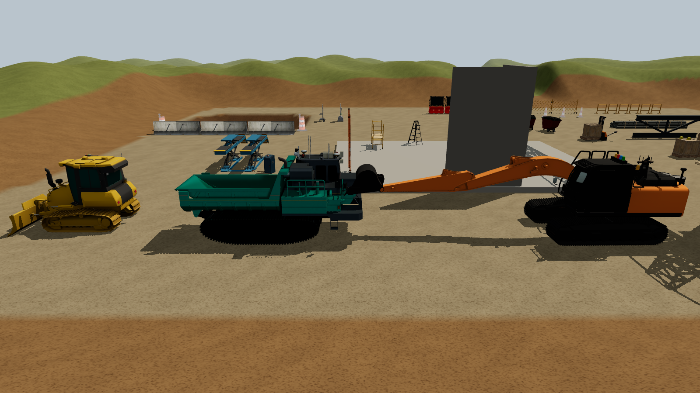

# Construction Site Simulation

[](https://github.com/dtt-github/construction-site-simulation/actions/workflows/ci.yml)
[](https://dtt-github.github.io/construction-site-simulation/)

An open-source, physically realistic construction-site simulator, built in the open by universities and industry.

Initiated and maintained by **[DigitalTwin Technology GmbH](https://www.digitaltwin.technology)**, the project's main contributor, as part of its work on **[ConstructionWare](https://www.constructionware.app)**.



**[Try the site in your browser](https://dtt-github.github.io/construction-site-simulation/)**, no GPU needed: the terrain, the SimReady props and the open machines run client-side (three.js + Jolt). The excavator and soil need the GPU server, so the demo plays a recorded dig–swing–load pass from it (ZX200 hydraulics, MPM sand, cylinder pressures; `phase2/record_replay.py`). Click *View pit* to watch it. For live control, see [Quick start](#quick-start).

**Goal:** a site you can trust numerically. Soil that digs like soil, machines whose hydraulics stall like real ones, and every model checked against measured data. Rigid-body site physics runs in the browser (three.js + Jolt). Soil and machine dynamics run on a GPU server (NVIDIA Newton: MPM sand, MuJoCo articulations) and stream into the same page.

## What works today

| Area | Status |
|---|---|
| Site | 128 m terrain with pad, haul road, stockpile and a 2.5 m excavation pit; 40+ physics props from NVIDIA SimReady (CC BY 4.0) with checked masses and colliders |
| Real machines (open-licensed) | Hitachi ZX200 excavator, Hitachi IC120 crawler carrier, Komatsu D37PXi dozer (articulated, from the PWRI OPERA project, Apache-2.0); 35 m tower crane, cones, barrels and jersey barriers (Gazebo, CC0) |
| Soil | The pit filled with 2 m of MPM soil (Newton implicit MPM) on the GPU, two-way coupled to the machine, in four presets switchable live: dry sand, moist sand, loam and clay. Cohesion is checked against vertical-cut stability and McKyes cutting forces, and dug clods break up to their remoulded strength; only soil near the bucket is particles, resting soil elsewhere is a heightfield, and cut faces slump to the angle of repose. The sand steps at 30 Hz and the machine at 60 Hz; the dig cycle runs at 1.3× real time, and a trench dug in one lane (1.2×) reaches 1.7 m with 43–45° sides |
| Excavator | The real Hitachi ZX200 (OPERA URDF geometry and joint limits, curved bucket with teeth) driven by its real hydraulic cylinders (Hitachi bores, 34.3 MPa main relief and port reliefs, pump flow shared between functions, bucket four-bar linkage) and swing motor (13.3 min⁻¹, 68.9 kN·m, braking on its cross-over reliefs), so force and speed vary with pose and the machine slows and stalls under load. Digging force at the teeth 149 kN against 151–158 kN published. Full dig–swing–load cycle into a dump truck, lifting while swinging like an operator: 15–18 s and about 1 t per pass |
| Browser client | Levers and keyboard control, cylinder pressure gauges, stall warnings, live truck load; 60 fps |
| Validation | Bucket forces compared with the McKyes/Reece earthmoving equation; field data wanted (see below) |

| Folder | What's in it |
|---|---|
| `feasibility.html` | Feasibility page (browser vs Omniverse decision, research summary, build plan) |
| `reports/`, `research_notes/` | Cited research on soil, machine and crane simulation, and the open 3D-asset survey |
| `phase0/` | Platform tests on the DGX Spark: Newton vs Chrono soil benchmark, Chrome WebGPU, Isaac Sim. See [`phase0/RESULTS.md`](phase0/RESULTS.md) |
| `phase1/` | SimReady → web pipeline (USD physics extractor, GLB checks, CoACD colliders) and the three.js + Jolt site. See [`phase1/RESULTS.md`](phase1/RESULTS.md) |
| `phase2/` | Newton soil servers: `excavator_server.py` (excavator with hydraulic-style actuators loading a dump truck, real-time soil zone in `soil_zone.py`) and `soil_server.py` (kinematic-bucket baseline). See [`phase2/RESULTS.md`](phase2/RESULTS.md) |
| `assets/` | Open asset library: registry, licenses, converted machines and build scripts. See [`assets/README.md`](assets/README.md) |

## Quick start

Developed on an NVIDIA DGX Spark (GB10, Linux aarch64). Any recent NVIDIA GPU on Linux should work.

```bash
# Python environment with Newton/Warp (see phase0/RESULTS.md for details)
uv venv phase0/.venv-newton && uv pip install -p phase0/.venv-newton "newton[examples]" playwright websockets gymnasium
# third-party assets that are not stored in git
phase1/fetch_assets.sh
python3 assets/fetch_assets.py
# soil + excavator server (ws://127.0.0.1:8765)
(cd phase2 && ../phase0/.venv-newton/bin/python excavator_server.py)
# site
python3 -m http.server 8731 --bind 127.0.0.1 --directory phase1
```

Open http://127.0.0.1:8731/web/index.html in Chrome. On Linux ARM, start Chrome with `--enable-unsafe-webgpu --enable-features=Vulkan`.

## For researchers: Python API

The excavator is a [Gymnasium](https://gymnasium.farama.org) environment ([phase2/excavator_env.py](phase2/excavator_env.py)). It uses the same simulator as the browser demo, without the browser:

```python
import excavator_env  # run from phase2/
env = excavator_env.ExcavatorEnv(soil="loam", task="load-truck")
obs, info = env.reset()
obs, reward, terminated, truncated, info = env.step(env.action_space.sample())
```

- **Actions:** the operator's four levers, each in [−1, 1]: swing (+ left), boom (+ raise), stick (+ out) and bucket (+ dump). They are held for one control step (10 Hz by default). The hydraulics and the soil decide how fast each joint actually moves.
- **Observations:** joint angles and rates, the four hydraulic pressures, the bucket's cutting-edge position, the soil force on the bucket, the load in the bucket and in the truck, and the pit surface as an 86 × 96 heightmap on a 0.1 m grid.
- **Tasks:** `load-truck` rewards tonnes added to the truck; `fill-bucket` rewards tonnes added to the bucket. You can also pass your own reward function.
- **Soil:** dry sand, moist sand, loam or clay (`soil=…`, or `reset(options={"soil": …})`).
- **Demonstrations:** with `autopilot=True`, the built-in operator model drives and `info["action"]` returns the levers it used. `record_demos.py` saves such episodes as `.npz` files for imitation learning.
- **Speed:** about 1.1–1.2× real time per environment on a GB10, about 11 control steps per second.
- **Determinism:** identical runs give identical results; Gymnasium's `env_checker` passes (`test_env.py`).
- **Units:** SI throughout. The coordinate frame is documented in the module.

## Join

This project needs people who know the real thing. See [CONTRIBUTING.md](CONTRIBUTING.md). The highest-value contributions:

1. **Measured data**: bucket and blade forces with soil properties, excavator pressure logs, crane load tests. Open a *Validation data* issue.
2. **Open 3D models of real machines**: wheel loaders, articulated dump trucks, mobile cranes, concrete mixers and pumps, rollers, workers. Read the [asset policy](assets/README.md) first. Manufacturers: releasing models under an open license helps every university and company using this.
3. **Physics**: cohesive and wet soils, real hydraulic circuits, crane ropes, tyre–soil contact.
4. **Calibration and benchmarks**: reproducible scenes with reference results.

## Open asset library

Every 3D asset is listed in [`assets/registry.json`](assets/registry.json) with its source, license, author and changes. `python3 assets/fetch_assets.py --check` validates the registry; `--notice` regenerates the attribution list in [NOTICE](NOTICE).

- **In the repo:** converted machines in `assets/machinery/`, site items in `assets/site/`, built by `assets/build_machines.py` and `assets/build_static.py` from their upstream sources.
- **Downloaded on demand:** NVIDIA SimReady site props (CC BY 4.0).
- **Candidates:** vetted, redistributable models that still need a manual download or conversion (Rocketbox construction-worker avatars, Sketchfab CC-BY wheel loader, articulated dump truck, mobile crane, mixer, pump, skid steer, telehandler). Good first contributions.

Only licenses that allow redistribution, modification and commercial use are accepted (CC0, CC-BY, CC-BY-SA, MIT, BSD, Apache-2.0). Machine models depict trademarked products; the licenses cover the models, not the trademarks, and no endorsement by the manufacturers is implied.

## Roadmap

- Operator models beyond the scripted cycle (learned or recorded operator inputs), and checking heaped bucket loads against field data
- Converged soil solves: loads still depend on the MPM iteration count
- Research APIs: the Gymnasium environment is done. Next: a ROS 2 bridge, and simulated sensors (depth camera or lidar, IMU)
- Measured ZX200 masses, swing torque and pressure logs for validation
- Measured pressure logs, port relief and house inertia to validate the hydraulics
- Soil–steel adhesion, bulking of dug clods, and soil presets calibrated to measured sites and bucket loads
- Validation against measurements ([phase2/RESULTS.md](phase2/RESULTS.md)):
  - Done: column collapse, and a clay soil-bin subsoiler (Makange 2021). Horizontal forces are within −7 to +9 % once the bin's layering is modelled.
  - Found:
    - The 30 Hz MPM step shortens fast flows.
    - Tall piles end up too flat.
    - Vertical tool forces are low.
    - Cutting forces depend on the MPM step, because the 150-iteration rheology solve does not converge, and the presets map φ with tan φ where Newton's cone needs sin φ. They are effective values for the operating setting; a converged, faster solve is the way out.
  - Next: a full-scale wheel-loader dig
- Wheel loader, articulated dump truck, mobile and tower crane dynamics with ropes
- Multi-user sessions and operator training scenarios

## License

Copyright 2026 DigitalTwin Technology GmbH and the Construction Site Simulation contributors.

Code: [Apache License 2.0](LICENSE). Assets and data: their own licenses, listed in [NOTICE](NOTICE) and [`assets/registry.json`](assets/registry.json). Physics libraries used: NVIDIA Newton and Warp (Apache-2.0), Jolt Physics (MIT), three.js (MIT), Project Chrono (BSD-3), CoACD (MIT).
