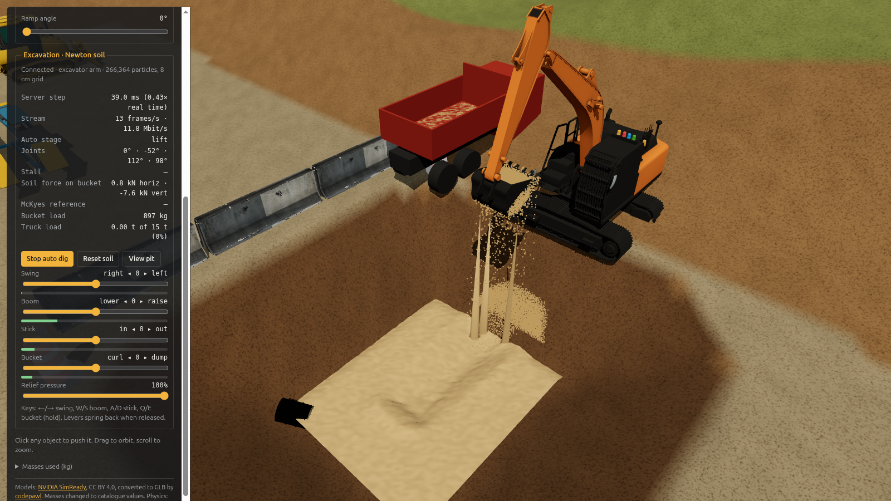

# Phase 2 results: Newton soil on the Spark, streamed into the three.js site

Date: 3 Nov 2026. Server: DGX Spark (GB10), Newton 1.7 / Warp 1.19. Client: the Phase 1 site in Chrome 156 (GPU, Vulkan).

## What it is

```
phase2/soil_server.py  (GB10)                         phase1/web/soil.js  (browser)
  Newton implicit MPM sand bed  ── WebSocket, binary ──▶ sand surface mesh (10 cm)
  kinematic steel bucket            ~6–120 KB/frame        moving grains (points)
  heightmap / grains / force        20–29 frames/s         bucket mesh, live stats
  auto dig cycle or manual targets ◀── JSON commands ──   Jolt heightfield mirror
```

- **Soil:** 266,364 MPM particles (8 cm grid, 4 cm spacing), dry sand (friction 0.75, φ ≈ 37°), 1,600 kg/m³. Fills the pit floor of the Phase 1 site, 6 × 5 × 0.5 m.
- **Bucket:** 0.9 m wide, 0.7 m deep, 0.6 m tall, four steel plates (friction 0.4). Moved kinematically toward targets with arm-like limits (0.6 m/s, 50°/s). The soil pushes back through MPM collider impulses, giving digging force.
- **Per streamed frame:** bucket pose; soil force on the bucket; bucket load (sand inside it); cutting depth and the McKyes/Reece reference force for that depth; a 60 × 50 surface heightmap built only from resting sand (< 0.3 m/s); and every grain moving faster than 5 cm/s (up to 40,000, quantised to 16 bits).
- **Browser:** the surface becomes a vertex-coloured mesh; moving grains are drawn as points. Every 0.5 s the surface is copied into a Jolt heightfield, so site props rest on the dug ground.
- **Controls** (panel "Excavation · Newton soil"): auto dig cycle, reset soil, view pit, and manual sliders for bucket position, height and curl.

## Measured

Headless (`--bench 20`, auto dig, `logs/bench_auto.json`):

| | |
|---|---|
| MPM step | 16 ms (60 Hz step) |
| Real-time factor incl. outputs | 0.92× |

Streaming to Chrome (`test_stream.py`, `logs/stream_test.json`):

| | Result |
|---|---|
| Server step while digging | 16–19 ms → 0.89–1.07× real time (1.3× when the bucket is out of the sand) |
| Frames received | 20–29 /s (30 /s target) |
| Bandwidth | ~1 Mbit/s idle; up to 28 Mbit/s with ~19,000 grains in flight |
| Site frame rate | 60 fps throughout |
| Errors | none in browser console or server |

One auto dig cycle (18 s):

| Stage | Bucket load | Horizontal force | McKyes reference |
|---|---|---|---|
| Penetrate | rising | 0.3–6 kN, plus ~24–45 kN vertical | 1.6–8 kN |
| Drag, 0.33 m cut | 180 → 650 kg | 6–19 kN | ~8 kN |
| Curl and lift | 650 → 600 kg | small; ~5–8 kN vertical (the load's weight) | – |
| Swing | 600 → 450 kg (spillage) | – | – |
| Dump | → 0 kg | – | – |

Sanity checks:
- **Load:** the bucket's geometric volume is 0.38 m³ (≈ 600 kg at 1,600 kg/m³). A heaped fill of 650 kg is plausible.
- **Drag force:** measured drag runs above the static McKyes value (about 8 kN at a 33 cm cut). That's expected: the reference has no surcharge term, while the bucket pushes a growing heap ahead of it. Phase 0 showed the analytic range itself spans about 3× depending on soil–steel friction. This is a plausibility check, not validation.

Screenshots: `logs/stream_dig.png`, `logs/stream_lift.png`, `logs/stream_dump.png`, `logs/stream_after_cycle.png`.

## Bugs found and fixed on the way

- `Jolt._malloc` isn't exported in JoltPhysics.js 1.1.1; scratch memory for `SetHeights` must come from `Jolt._webidl_malloc`.
- After a soil reset, the server's send clock stayed at the old time and stopped streaming.
- numpy `float32` values crashed the JSON stats print once the bucket touched sand.
- A max-height surface pulled carried sand into a "curtain" up to the bucket. The surface now uses resting sand only, and moving sand is drawn as grains.

## Limits (next steps)

- **Fixed zone, not a moving active zone.** The whole pit floor is particles. The research design (particles only near the tool, a heightfield elsewhere, converting between them) isn't built yet.
- **Kinematic bucket.** It follows its targets regardless of resistance. A joint-driven excavator with hydraulics would slow or stall against hard digging.
- **Sand only.** No cohesion, moisture or compaction; no calibration against measured forces yet.
- **Coupling is one-way** for site props: they rest on the sand surface but don't push the sand.
- **Bandwidth peaks near 28 Mbit/s.** Fine on a local network; remote viewers would need delta-coding or fewer grains.
- **The browser pane** in the Claude app pauses animation when hidden; use real Chrome to watch.

## Run it

```bash
# 1. soil server on the Spark (Newton venv from phase0)
phase0/.venv-newton/bin/python phase2/soil_server.py            # ws://127.0.0.1:8765
# 2. site
python3 -m http.server 8731 --bind 127.0.0.1 --directory phase1
# 3. open http://127.0.0.1:8731/web/index.html  (Chrome on the Spark: --enable-unsafe-webgpu --enable-features=Vulkan)
#    another soil host: ...index.html?soil=HOST:8765
```

Headless benchmark: `phase0/.venv-newton/bin/python phase2/soil_server.py --bench 20 --out phase2/logs/bench_auto.json`

---

# Phase 2b: joint-driven excavator arm (`excavator_server.py`)

The kinematic bucket is replaced by the arm of a ~20 t backhoe excavator standing on the ground at the pit edge. `soil_server.py` stays as the kinematic baseline; the browser client (`phase1/web/soil.js`) recognises either server.

## Model

| Part | Value |
|---|---|
| Boom | 5.7 m, 1,800 kg, foot pin 4.1 m above the pit floor (1.8 m above ground) |
| Stick | 2.9 m, 900 kg |
| Bucket | 1.2 m wide, 0.9 m deep, 0.8 m mouth (~0.86 m³), 700 kg; 5 steel plates |
| Joints | 3 revolute (boom, stick, bucket), Newton articulation solved by MuJoCo (GPU), 4 substeps per 1/60 s frame, recorded as one CUDA graph |
| Sand coupling | Two-way: the bucket and stick are dynamic MPM colliders; sand impulses become forces/torques on the links (Newton's `mpm_twoway_coupling` pattern) |
| Hard ground | Bucket and stick collide with the pit floor under the sand (rigid contact) |

Hydraulic-style actuator per joint (`hydraulics_kernel`):
- **Flow:** the lever (−1…1) sets a joint speed up to the maximum (boom 0.35, stick 0.5, bucket 0.9 rad/s). A reference angle advances at that speed.
- **Stiff servo:** τ = Kp·(ref − q) + Kd·(v_cmd − q̇).
- **Relief valve:** τ is capped at the relief torque (boom 450, stick 160, bucket 120 kN·m, scalable 30–100 % from the UI). The reference may lead the joint by at most τ_max/Kp, so a blocked joint doesn't wind up: it slows, then stalls, and moves again when the resistance drops.

Holding with levers neutral: the boom sags 0.2° under full gravity load at 29 % of its relief pressure.

Auto dig cycle: approach → penetrate → drag → curl → lift → dump, defined as bucket-pin waypoints solved by inverse kinematics. The cycle only advances along a segment while the arm keeps up, so a stalled arm holds the cycle rather than skipping ahead.

## Measured

Headless, 40 s auto digging (`logs/exc_bench.json`):

| | |
|---|---|
| Frame time | 23–25 ms (MPM ~19.5 ms, arm ~3 ms) → **0.73× real time** |
| First-pass bucket load | ~820 kg (later passes ~400 kg: the fixed path digs an already-cut trench) |
| Peak relief-pressure use | boom 43 %, stick 55 % (during drag), bucket 20 % |

Stall tests (`--stall-test`, `logs/exc_stall.json`, and in the browser via `test_excavator.py`, `logs/exc_test.json`):

| Test | Result |
|---|---|
| Full relief, boom down + stick out into the sand | Pushes through 0.5 m of dry sand (a 20 t machine should). On reaching the hard floor, boom and stick sit at **100 % pressure, speed 0**. Browser shows "Boom, Stick at relief" |
| 35 % relief, hard cut | All three joints pinned at 35 %, arm stopped with ~1 t of sand in the bucket |
| 40 % relief, stick crowd through sand (browser, keyboard) | Stick stalls at its relief pressure (flagged). As the sand yields it creeps, then breaks free and returns to full speed (0.5 rad/s) |

Browser (Chrome on the GB10): 60 fps; stream 18–28 frames/s at 1–7 Mbit/s; no console errors. Screenshots: `logs/exc_drag.png`, `logs/exc_curl.png`, `logs/exc_lift.png`, `logs/exc_dump.png`, `logs/exc_floor_stall.png`, `logs/exc_weak_stall.png`.

Controls: Boom / Stick / Bucket levers (spring back on release) or keys W/S, A/D, Q/E; Relief pressure slider; per-cylinder pressure gauges (green, amber above 70 %, red at relief).

## Performance notes

- MPM with Newton's fixed grid (copied from the coupling example) cost 117 ms/step; the default sparse grid is 19.5 ms.
- GPU MuJoCo costs 1.7–3.5 ms per substep as separate kernel launches; recording the substeps as a CUDA graph cuts the whole rigid part to ~3 ms per frame.
- A second simulation sharing the GPU (e.g. a forgotten server) roughly doubles every timing. Run one server at a time.
- To reach real time: fewer particles (`--voxel 0.09`, ~30 % fewer) or a moving active zone.

## Limits

- **Simplified hydraulics.** No cylinder geometry, pump flow sharing between functions, or engine power limit. Each joint has its own flow and relief limit, and torques are applied at the joint rather than through cylinder linkages.
- **No swing or travel.** The upper structure doesn't rotate and the tracks don't move; the machine body is cosmetic.
- **Simplified arm contact.** Arm links collide only with the pit floor and the sand, not with the pit walls or each other.
- **0.73× real time** with the full 266k-particle bed.

---

# Phase 2c: swing and truck loading (full dig–swing–load cycle)

## What changed

| Part | Detail |
|---|---|
| Swing | 4th joint about the vertical axis between the undercarriage and a new house body (8 t: house, counterweight, cab). Hydraulic-style like the others: 0.8 rad/s flow limit, 65 kN·m relief torque, so the swing accelerates at a torque-limited rate |
| Dump truck | Rigid tipper parked on the machine's right at ground level. Bed 4.2 × 2.3 × 1.0 m, floor 1.75 m above ground, rated 15 t. The bed plates are MPM colliders (sand lands in it) and rigid colliders (the bucket can hit it) |
| Spill surfaces | Ground slabs behind the machine and beside the pit, plus sloped pit sides (1V:1.5H, matching the site terrain) on the machine and truck sides, so spilled sand lands where the ground actually is. The two vertical containment walls on those sides were removed |
| Bucket | Back fully closed (only the mouth is open). Plates 10 cm thick so the 8 cm MPM grid can't leak sand through them |
| Joint limits | Boom raise to 69° and bucket curl to −120°, about real machine ranges; needed to lift over the truck sides |
| Auto cycle | approach → penetrate → drag → curl → lift → swing to truck → dump → raise → swing back → lower. Each pass digs 15 cm deeper (up to 45 cm), like an operator working down |
| Streaming | `EXC2` frames: 4 link poses, 4 joint states, truck load and capacity, and a second heightmap (10 cm) for the sand in the bed. Grains are streamed when moving or lying outside the pit and bed (spill) |
| Browser | House swings with the arm; tracks and truck drawn from server geometry; truck-bed sand surface; Swing lever (←/→); "Truck load x t of 15 t" readout |

## Measured

Headless, 60 s auto (`logs/load_bench.json`), 0.67× real time:

| Pass | Bucket after curl | Delivered to truck | Truck total |
|---|---|---|---|
| 1 | 611 kg | 524 kg | 0.52 t |
| 2 (15 cm deeper) | 505 kg (stick at 65 % relief) | 512 kg | 1.04 t |

- **Cycle time:** about 27 s (a real 20 t excavator loading a truck: about 15–20 s).
- **Swing:** at its relief torque while accelerating and braking, as in a real swing circuit.
- **Payload:** 500–600 kg per pass against a bucket rated about 0.86 m³ (~1.4 t). The dig path is short, and sand spills during lift and swing (visible as falling grains). A fuller bucket needs a longer drag and a gentler swing profile.

Browser (`test_excavator.py`, `logs/load_test.json`):

| Check | Result |
|---|---|
| Auto cycle | Truck 0 → 0.52 t after the first pass; second pass under way |
| Manual swing (hold ←) | −37° → +13° in 3 s |
| Floor stall at full relief | Boom and stick flagged at relief |
| Speed | 0.53–0.93× real time; stream 11–26 frames/s; site 60 fps; no console errors |

Headless stall test with the swing joint (`logs/exc_stall.json`): at full relief the arm stops on the hard floor (boom and stick at 100 %, speed 0). At 35 % it stalls in the sand with 687 kg in the bucket.

Screenshots: `logs/load_drag.png`, `logs/load_lift.png`, `logs/load_swing.png`, `logs/load_dump.png`, `logs/load_after_two_loads.png`.

## Lessons

- A loaded bucket swung back while lowering jams against the truck side. The cycle needs separate raise → swing → lower steps.
- Interpolating the dig stages in joint space bends the drag path; interpolate the bucket-pin path (task space) instead.
- MPM collider cost grows with the number of large colliders near the sand. Two big slope boxes added ~6 ms; removing the two vertical walls they replaced brought it back to ~19.5 ms idle.
- A forgotten server on the GPU halves throughput. Stop servers between runs; the stale one here was stopped through its background task, since killing GPU processes directly was blocked by the sandbox.

## Limits

- **Static truck.** It doesn't drive away or tip. Reset soil empties it.
- **Spill on other sides.** Sand spilled on the −x/−y sides or beyond the slabs falls to the pit-floor level.
- **Speed.** 0.5–0.9× real time with the full bed and a browser attached.

---

# Phase 2d: payload tuning (toward the bucket's 1.38 t rating)

## Changes

| Change | Why |
|---|---|
| Bucket outer 1.0 × 0.85 × 1.3 m (inside 0.9 × 1.2 × 0.8 m = 0.86 m³ ≈ 1.38 t), 800 kg | The 10 cm anti-leak plates had shrunk the inside to 0.66 m³; restored to a 20 t machine's general-purpose bucket |
| **MPM solver iterations 30 → 60** (server default) | At 30, carried sand slowly *creeps* out of a stationary bucket (739 → 649 kg in 7 s, held still). At 60 the load holds (859 → 861 kg); at 100 the same (867 → 853). The under-converged frictional solve made dry sand behave like a slow fluid. This was the main loss |
| Cylinder end stops + reference clamped to the stroke | A joint back-driven by load could drag its reference past the joint limit (stick reached +88° against a −29° limit). Now a stiff end stop, not limited by relief, holds each joint inside its range |
| Floor-safe dig paths | Deeper passes are raised until the bucket's lowest corner stays ≥ 8 cm above the hard pit floor along the whole path into each dig waypoint (`_stage_z`) |
| Stage timeouts | The auto cycle skips a stage after 4 s of poor tracking, or when it takes > 3× its planned time (slow creep at relief), so a stall can't hang the cycle |
| Dig lanes | Each pass shifts the dig path to a fresh lane (swing offsets 0, +9°, −9°, +17°, −17°, about one bucket width at 6–8 m), and deepens only after every lane is dug |
| Per-stage speed field in `CYCLE` | Lets a stage run at a fraction of full lever (used for gentle-swing experiments) |
| `tune_payload.py` | One pass per cycle variant on a fresh bed, logging bucket load at every stage and the truck load after settling |

## Variant comparison (one pass, fresh bed; `logs/payload_*.json`)

At 30 solver iterations (rounds 1–2, before the convergence fix):

| Variant | To truck | % of 1.38 t |
|---|---|---|
| baseline | 760 kg | 55 % |
| long drag + curl while dragging | 744 kg | 54 % |
| long drag + curl, gentle lift/swing | 668 kg | 49 % |
| baseline, full curl, gentle lift/swing | 654 kg | 48 % |

At 60 solver iterations (rounds 3–5):

| Variant | To truck | % of 1.38 t | Peak in bucket | After curl | After lift | After swing | Cycle |
|---|---|---|---|---|---|---|---|
| **baseline (adopted)** | **893 kg** | **65 %** | 1,090 | 883 | 856 | 811 | **24.2 s** |
| long drag + curl while dragging | 897 kg | 65 % | 1,059 | 927 | 852 | 770 | 26.2 s |
| long drag + curl, gentle lift/swing | 869 kg | 63 % | 1,062 | 928 | 832 | 740 | 28.6 s |
| long drag, slow curl, gentle | 870 kg | 63 % | 1,063 | 932 | 835 | 743 | 28.7 s |
| baseline, full curl, gentle lift/swing | 832 kg | 60 % | 1,094 | 885 | 793 | 708 | 27.6 s |
| baseline from a longer reach | 868 kg | 63 % | 1,122 | 867 | 833 | 792 | 25.5 s |
| deep drag, early curl | 779 kg | 57 % | 829 | 805 | 742 | 678 | 25.3 s |
| deep drag, early slow curl | 776 kg | 56 % | 822 | 800 | 741 | 674 | 25.8 s |

"To truck" includes the heap above the bucket's mouth, which the bucket-load counter (inside the plates only) doesn't see. That's why it exceeds the "after swing" figure.

Findings:
- **Gentler lift and swing never helped.** Loss scaled with time in the air (creep), not with acceleration. Once creep was fixed, speed made little difference, so the fastest cycle wins on throughput.
- **Curling early cuts less.** It shortens the effective cut from 2.6 m to 1.7 m.
- **The baseline drag–curl path is the best throughput:** 893 kg in 24.2 s ≈ 133 t/h. It stays the default cycle.

## Multi-pass result (`python excavator_server.py --bench 130`, `logs/payload_bench_lanes.json`)

| Pass | Lane | Bucket after curl | Delivered | Truck total |
|---|---|---|---|---|
| 1 | 0° | 1,081 kg | 892 kg | 0.89 t |
| 2 | +9° | 961 kg | 862 kg | 1.75 t |
| 3 | −9° | 992 kg | 902 kg | 2.66 t |
| 4 | +17° | 916 kg | 841 kg | 3.50 t |

- **Payload:** mean 874 kg per pass (64 % of the 1.38 t rating), sustained. Before this round, passes delivered 524 and 512 kg, and without lanes passes 2–3 dropped to 429 and 257 kg because the arm re-cut its own trench.
- **Cycle time:** 27–30 s per cycle in this run. The truck reached 3.5 t after 108 s.
- **Speed:** 0.44× real time headless at 60 iterations, against 0.67× at 30. The extra solver work is the price of sand that stays in the bucket. Per frame while digging: 30 it 23.9 ms, 60 it 30.2 ms, 100 it 38.5 ms.

Stall test (`--stall-test`, `logs/exc_stall.json`): at full relief, the bucket on the hard floor puts boom and stick at 100 %, speed 0. At 35 % relief, boom and stick sit at 35 % with the stick held at its end stop (−29°). Before the end-stop fix it was being pushed past it.

Browser (`test_excavator.py`, `logs/payload_browser_test.json`): truck 0 → 893 kg on the first pass; site 60 fps; no console errors; floor stall flags boom and stick; 40 % relief flags the stick. In this run the manual-swing check hit swing relief (100 %) without moving, because the auto cycle had been stopped with the bucket buried mid-drag. A 65 kN·m swing can't drag a buried bucket sideways, so this is correct behaviour, not a key-handling fault.

## Why not 1.38 t

- **The bucket fills to only ~1.08 t (79 %) during the drag.** The mouth faces the machine almost horizontally while dragging, so the upper part of the bucket stays empty. Real buckets have a curved shell and teeth that pull material in; this one is a box.
- **About 200 kg spills during the curl.** The heap above the mouth slides off as the bucket rotates. Another 70–120 kg goes in the lift and swing.
- **Next steps:** a curved-shell bucket collider (several plates approximating the profile) and teeth; a drag that follows the bucket's own path ("heel–toe" kinematics) rather than a straight pin line; and calibration against field fill factors (typically 90–110 % of rated for loose sand).

# Phase 2e: the real Hitachi ZX200 in the physics server

The soil server now simulates the same machine the browser shows: the Hitachi ZX200 (20 t class) from the PWRI OPERA project (Apache-2.0), replacing the generic 4-joint arm.



## What changed

| Change | Detail |
|---|---|
| **URDF link frames** | Boom, stick and bucket joints use the OPERA URDF joint origins, fixed pitches and limits (boom −65°…+57°, stick 34°…154°, bucket −36°…136°). The physics links are the URDF frames (`body_link`, `boom_link`, `arm_link`, `bucket_link`), so joint angles are URDF angles. Pin to pin: boom 5.69 m, stick 2.90 m; the boom foot sits 0.055 m ahead of and 0.72 m above the swing joint, which is 1.12 m above the track bottom |
| **Real machine in the browser** | The hello message names `assets/machinery/opera_zx200.glb`. `soil.js` clones each link's meshes and places them at the streamed link poses (boxes remain as a fallback). The crawler is drawn parallel to the pit edge |
| **Curved bucket with teeth** | The inner shell profile is traced from the OPERA bucket mesh (17 points) and built from 16 shell plates, 22 side strips that stop at the mouth plane, and 5 teeth reaching 0.18 m past the lip. Inside width 1.06 m: 0.79 m³ struck, 0.91 m³ heaped (SAE J296) from the geometry. The bucket load counts grains inside the profile polygon (new `bucket_profile_fill_kernel`) |
| **Rating** | ZX200-6 standard bucket, 0.80 m³ ISO heaped → **1.28 t** of sand at 1,600 kg/m³ (was 1.38 t for the old box bucket) |
| **Masses** | Estimated from published 20 t class figures: upper structure 9,800 kg (with a 4.6 t counterweight), boom 1,450 kg, stick 680 kg, bucket 640 kg. Centres of mass and inertias come from the area-weighted mesh shells. **These are estimates; measured values are wanted** |
| **Levers** | Unchanged for the operator (raise / out / dump positive). They are mapped onto URDF signs with `LEVER_SIGN` |
| **Auto cycle** | Penetrate at 7.6 m instead of 7.9 m, because the real boom foot sits 0.45 m further back than the old one. New *drag-curl* stage: keep dragging while the bucket curls, so the 1.2 m mouth fills toward the top |
| Machine position | Swing axis moved from x = 7.0 to 7.4 m (zone frame) so the tracks overhang the pit slope less |

## Dig-path comparison (one pass, fresh bed; `python tune_payload.py`, `logs/payload_*.json`)

| Variant | To truck | % of 1.28 t | Peak in bucket | After curl | After lift | After swing | Cycle |
|---|---|---|---|---|---|---|---|
| baseline (old path) | 543 kg | 42 % | 623 | 603 | 554 | 489 | 23.8 s |
| long drag | 674 kg | 53 % | 742 | 705 | 685 | 607 | 24.3 s |
| **drag + curl while dragging (adopted)** | **869 kg** | **68 %** | 955 | 907 | 892 | 773 | **23.8 s** |
| raked drag + curl | 652 kg | 51 % | 726 | 693 | 669 | 593 | 29.1 s |

On the real bucket the teeth are the lowest point at every attitude. The 0.5 m sand bed over a hard floor therefore limits the cut to about 0.4 m. A straight drag fills only the lower part of a 1.2 m mouth; curling while dragging fills the rest.

## Multi-pass result (`python excavator_server.py --bench 130`, `logs/zx200_bench.json`)

| Pass | Peak in bucket | Delivered | Truck total |
|---|---|---|---|
| 1 | 949 kg | 864 kg | 0.86 t |
| 2 | 1,036 kg | 926 kg | 1.79 t |
| 3 | 1,137 kg | 1,060 kg | 2.85 t |
| 4 | 1,132 kg | 1,007 kg | 3.86 t |

- **Payload:** mean **964 kg per pass, 75 % of the 1.28 t rating**. Phase 2d's box bucket averaged 874 kg (64 % of 1.38 t). The truck holds 4.9 t at 130 s, against 3.5 t at 108 s before.
- **Cycle:** about 28 s. **Speed:** 0.43× real time headless (60 MPM iterations), unchanged.
- **Hold test:** the arm holds its pose with 2 cm sag; the boom sits at 26 % of relief.

Browser (`test_excavator.py`, `logs/zx200_browser_test.json`, screenshots `logs/load_*.png`, `logs/exc_*.png`):
- The ZX200 model loads.
- Site runs at 59–60 fps with no console errors.
- First pass: 864 kg in the truck.
- Manual swing moves.
- Bucket on the floor: boom and stick flagged at relief.
- At 40 % relief: the stick is flagged.

## Limits and next steps

- **Cylinders and linkage are not rigged.** The OPERA package has cylinder meshes, but no joints for them, so they aren't drawn. Relief torques are still per joint rather than computed from cylinder force through the linkage geometry.
- **Masses are estimates.** Hitachi or ZX200 owners with weighed components or pressure logs can turn this into a validated model (see CONTRIBUTING).
- **Shallow test bed:** a 0.5 m sand layer. A deeper bed (more particles, slower) would allow full-depth cuts and is needed to judge fill factors against field data (90–110 % for loose sand).
- **Swing is still the old 65 kN·m relief value.** The real ZX200 swing torque should be checked.

# Phase 2f: real-time soil (moving particle zone, heightfield elsewhere)

The ZX200 cycle ran at 0.43× real time with the full 266k-particle bed. It now runs at **1.12× real time** with the same digging behaviour: only the soil near the bucket is MPM particles. `soil_zone.py`, used by `excavator_server.py`.

## Where the time went

Profiled at the 8 s mark of the old bench (`SolverImplicitMPM` section timers):

| Part | ms per 60 Hz frame |
|---|---|
| MPM step (266k particles, 60 iterations) | 32.3 (strain solve 18.4, colliders 7) |
| Rigid arm (MuJoCo GPU, CUDA graph) | 0.95 |
| Measurements and stream (30 Hz) | 0.3 |

Two Newton details shaped the design:

- **Inactive particles still cost.** With the default sparse grid, voxels are allocated for every particle, active or not. Parking inactive particles at a single point made the step 13× slower (all of them binned into one cell). They are parked instead in a compact block, about 26 per voxel.
- **About 8 ms per step is fixed overhead.** Even one solver iteration costs about 8 ms (per-step grid build and the re-captured inner solver graph). Newton's capturable mode (rebuildable sparse grid) was slower here: 32–36 ms, because collider and solve kernels run over the reserved capacity. Halving the active particles therefore saves only the iteration part.

## How it works

- **Dormant soil.** Resting soil is stored as a particle count per 8 cm column, over two regions: the truck bed, and the pit with its slopes and the ground around it. That keeps mass exact. A column's top is floor + count × 1 cm.
- **Heightfield collider.** One Warp mesh holds a top quad per column, plus vertical walls between columns and at region borders. Wall winding makes each normal point to the lower side. Active sand rests on dormant columns and against them. Columns with no dormant soil sit at their floor, the lowest ground under them, so on slopes the mesh is buried and Newton's most-penetrated-collider rule ignores it.
- **Wake.** A dormant column wakes when it is within 0.5 m of the bucket's bounding box and its top is no more than 0.6 m below the bucket. Its count becomes fresh particles on a 4 cm lattice, stacked on the real ground under each sub-column.
- **Sleep.** A column sleeps when it is outside 0.8 m and all its particles are slower than 4 cm/s. Its particles are added back to the count and parked.
- **Pool.** The pool is 120k particles. Updates run at 15 Hz and take about 0.2 ms.
- **Display.** The pit and truck heightmaps include dormant columns. Dormant spill on slopes and ground is streamed as grains, one per particle, as before.
- **Leaks.** Particles that fall through the ground are removed and counted as lost (17 in 130 s, about 2 kg). The leak itself predates the zone: the full-bed server loses particles at the same static-collider seams (pit corner, slope toes), where they then fell forever.

## Result (`python bench_zone.py`, `logs/zone_bench.json`; 130 s auto cycle, same as the Phase 2e bench)

| | Full bed (2e) | Moving zone |
|---|---|---|
| Real-time factor | 0.43 | **1.12** |
| Frame cost, mean / dig stages / p95 | 47 ms / – / – | 14.7 / 16.3 / 18.9 ms |
| Active particles, dig mean / max | 266k | 41k / 60k |
| Passes in 130 s | 4 | 4 |
| Per pass to the truck | 864, 926, 1060, 1007 kg | 867, 898, 1023, 951 kg |
| Mean per pass | 964 kg (75 % of rated) | 935 kg (73 %) |

The first pass follows the full-bed run closely: same forces through the drag, and 885 kg against 864 kg delivered. Pass loads stay within 3 %.

The wake margin was compared at 0.8 m (72k active while digging) and 0.5 m (59k). The loads matched (956 vs 950 kg), so the smaller margin is the default. Those two runs were made before the ground region existed, while slope spill stayed active and slowed frames to about 21 ms.

Browser (`test_excavator.py`, `logs/zone_browser_test.json`):
- Two loads, 873 kg and 926 kg, in 56 s.
- Server 0.83–1.49× real time over the cycle, at least 1.0 outside the hardest cuts.
- Site at 60 fps.
- Stall flags work for the floor and for 40 % relief.
- No console errors.
- The panel shows the active particle count.

## Limits

- **Dormant soil is rigid.** It doesn't fail. The 0.5 m margin covers the failure wedge of the cuts made here, but deeper or wider cuts may need a larger margin; pass loads are the check.
- **Digging stages sit near the budget.** They average 16.3 ms against 16.7 ms, with p95 at 18.9 ms, so hard cuts briefly drop below real time. The fixed per-step MPM overhead (about 8 ms) is the next target, either a lighter Newton configuration or a capturable step that stays fast. (Done: the sand now steps at 30 Hz; see "Sand at 30 Hz, machine at 60 Hz".)
- **Stream size is about 35 Mbit/s,** mostly grains. Dormant spill could be sent as a heightmap instead.
- **The bed is still 0.5 m deep.** A deeper bed now costs little: only the zone's columns get taller.

# Phase 2g: real hydraulics (cylinders and bucket linkage)

Boom, stick and bucket are now driven by the ZX200's cylinders instead of joint-space actuators with fixed torque caps (`hydraulics.py`). Speed and force now depend on the pose and the direction, as on the machine. The cylinders and the bucket linkage are drawn in the browser.

## Data

From the Hitachi ZAXIS 200 brochure:

| | Value |
|---|---|
| Boom cylinders | 2 × bore 120 mm, rod 85 mm |
| Arm cylinder | bore 135 mm, rod 95 mm |
| Bucket cylinder | bore 115 mm, rod 80 mm |
| Implement relief | 34.3 MPa (36.3 MPa power boost) |
| Swing relief | 30.4 MPa |
| Main pumps | 2 × 194 L/min |

**Pin positions.** The OPERA package ships cylinder and linkage meshes that its URDF doesn't use. Its link meshes are in the URDF link frames, so pin positions come from a Hough vote on the pin bosses: faces whose normals are perpendicular to the pin axis vote along their normals, and bore centres stand out. Where several bosses were candidates, the one whose cylinder travel over the URDF joint limits matches Hitachi's stroke was kept:

| Cylinder | Travel in the model | Published stroke |
|---|---|---|
| Boom | 1.28 m | 1.26 m |
| Arm | 1.465 m | 1.475 m |
| Bucket (through the four-bar) | 1.04 m | 1.06 m |

The bucket's guide link (0.561 m) and side link (0.583 m) are measured from their own meshes.

## Model

- **Joint torque.** τ = F · dL/dq, where L(q) is the pin-to-pin cylinder length. For the bucket, L comes through the four-bar: guide link from the arm, side link from the bucket, both meeting the rod at one pin.
- **Relief.** The cap is p_relief × head area when pushing and p_relief × rod-side area when pulling, multiplied by the current moment arm. It is set per frame, so each direction has its own limit and both change with pose. The relief slider now acts at runtime; before, its value was frozen into the recorded CUDA graph.
- **Flow.** A lever opens its spool. Cylinder speed is spool flow divided by the area being filled; boom and arm get both pumps, the bucket one. Open spools share the 388 L/min. Joint speed is cylinder speed divided by dL/dq.
- **Gauges.** They show the loaded side's pressure as a fraction of 34.3 MPa. The panel also lists each cylinder's pressure in bar and which side is loaded.

## Check against published forces

Forces at the teeth at relief, with the pin to tooth tip at 1.50 m:

| | Model, 34.3 MPa | Model, power boost | Hitachi (dealer listings) |
|---|---|---|---|
| Bucket digging force | 149 kN | 158 kN | 151–158 kN |
| Arm crowd force (bucket in line) | 96 kN | 102 kN | 109–114 kN |

## Results

`bench_zone.py`, `logs/hyd_bench.json`; 130 s auto cycle:

| | Joint actuators (2f) | Cylinders |
|---|---|---|
| Real-time factor | 1.12 | 1.07 |
| Per pass to the truck | 867, 898, 1023, 951 kg | 976, 1022, 1146, 1044 kg |
| Mean per pass | 935 kg (73 % of rated) | **1047 kg (82 %)** |

The arm is stronger than the old 160 kN·m cap: up to 420 kN·m at mid-stroke. It cuts through more of the drag, so passes are fuller.

Typical pressures in a pass:
- Boom rod side at relief (−343 bar) while it presses the bucket down during the drag.
- Arm at 100–190 bar while dragging.
- Bucket cylinder at about 160 bar holding the curled load during the swing.
- Boom at 60–90 bar holding the arm up.

Hold test: 2 cm sag, boom at 64 bar.

Browser (`test_excavator.py`, `logs/hyd_browser_test.json`):
- Loads of 987 kg and 1056 kg in 50 s, at 60 fps with no errors.
- Bucket on the floor: boom and stick at −343 bar, flagged as stalled.
- At 40 % relief: the stick stalls at 137 bar, which is 40 % of 343.

Screenshots: `logs/hyd_lift.png`, `logs/hyd_linkage.png`, `logs/hyd_arm_cylinder.png`.

**Also fixed:** the auto cycle's swing hunted between lanes at the start of each pass (±25° at relief). When the pass count rose, the start of the lower→approach segment was re-evaluated for the next lane. This was in the old version too.

## Limits

- **The boom nears toggle at its lowest position.** The moment arm drops toward zero in the last 0.3 rad of boom-down travel; speed commands use a 5 cm floor there.
- **The bucket is weak near full curl.** The moment arm is about 5 cm while the curled bucket is carried, which is real four-bar behaviour. The load is held at about 160 bar.
- **No line or port relief.** The real valve has overload reliefs above 34.3 MPa that let an externally loaded cylinder yield. Here one relief value caps both pushing and holding.
- **Swing is still a joint motor** at 65 kN·m. Swing relief and motor displacement would make it physical. (Done: see "Hydraulic swing, port reliefs and an operator-style cycle".)
- **The rod meshes are slightly short.** Near full extension a few cm of gap shows between rod and barrel.

## Recorded replay for the static demo

GitHub Pages has no GPU server, so `record_replay.py` records one auto pass headless:
- The hello message plus the frames the WebSocket would have sent, at 15 Hz with grains thinned to 3000 per frame, gzip-compressed.
- The result is `assets/replay/zx200_cycle.bin.gz`: 27 s, 404 frames, 5.0 MB (10.2 MB uncompressed).

When no server is connected, `soil.js` plays it in a loop through the normal frame path, so the cylinders, pressures, stall flags, pit, truck and grains all show as live. The levers are disabled. `?replay` forces it locally. In a local static-site test, the replay loaded in 3.8 s and played at 60 fps with no errors. Re-record after physics changes, so the demo matches the code.

# Phase 2h: deep bed and trenching

The pit (2.35 m deep, 1:1.5 sides) is now filled with 2 m of sand, up from a 0.5 m layer on its floor: about 1.5 million particles' worth, nearly all of it dormant.

**Soil zone changes (`soil_zone.py`):**
- **Partial wake.** A column becomes particles only from its top down to 5 cm below the bucket's bounding box. The level rises 1:1 with horizontal distance from the bucket. The soil underneath stays a dormant base under the active sand. Without this, a 2 m column would wake whole and the zone would need about 3× more particles.
- **Avalanche wake.** Dormant soil more than 0.2 m above a neighbour wakes down to the 37° repose line, so trench faces slump instead of standing as rigid walls. Smaller steps are below MPM's 8 cm resolution, and waking them only churned.
- **Minimum awake time.** A woken column stays awake for at least 0.5 s before it can sleep, so its sand can flow first. Without this, fresh, motionless particles went back to sleep at once and woke again on every update.
- **Sleep margin** reduced from 0.8 m to 0.6 m. **Pool** raised to 150k (`--pool` sets it).

**Display.** The pit heightmap now covers the filled sides as well (9.6 × 8.6 m).

**Dig cycle.** The waypoints follow the bed top. Dig stages cut to 0.42 m below the top plus the deepening, which reproduces the first pass of the 0.5 m bed. `--trench` (`set_trench`) digs one lane and goes 0.25 m deeper every pass, down to the floor clearance.

## Results

**Normal cycle** (`bench_zone.py 130`, five lanes): 1.075× real time. Frames average 15.4 ms (17.0 ms while digging; p95 21.8 ms). Particles active while digging: 60k on average, 134k at most. Per pass: 1097, 1036, 1172, 979 kg, mean 1071 kg; the 0.5 m bed gave 1047 kg.

**Trench** (`bench_trench.py 8`, `logs/trench_bench.json`), one lane, 8 passes in 266 s:

| Pass | 1 | 2 | 3 | 4 | 5 | 6 | 7 | 8 |
|---|---|---|---|---|---|---|---|---|
| To the truck (kg) | 1099 | 1441 | 1712 | 1764 | 1885 | 1717 | 1412 | 1085 |
| Frame (ms) | 14.7 | 15.2 | 17.2 | 17.2 | 17.5 | 18.7 | 20.8 | 20.8 |

Cross-sections across the lane at the end:

| Position | Depth | Width at half depth | Side slopes |
|---|---|---|---|
| x = 0 | 1.78 m | 2.4 m | 42° and 37° |
| x = 1 m | 1.56 m | 2.3 m | 34° and 37° |
| x = 2 m (shallower end of the drag) | 1.0 m | 2.3 m | 12° and 20° |

Sand's angle of repose here is 37°, so the slumped trench walls come out at the angle they should.

**Limits found:**
- **Heaped loads.** Deep passes carry 1.7–1.9 t, 30–50 % over the rated 1.28 t, as cut faces slump into the bucket mouth during drag and curl.
- **Stalls at relief.** From pass 3, drag-curl, curl and lift time out (16 skipped stages by pass 8) with 0.12–0.37 rad tracking errors. That is the hydraulics at relief under heaped loads plus overburden: the auto operator takes too big a bite. An operator would take shallower cuts as the trench deepens. The next step is an adaptive cycle.
- **Speed in deep passes.** Deep passes wake up to 150k particles, and the run averages 0.92× real time. The 150k pool runs short at the deepest passes (469 times). A 220k pool removes that but makes no difference to loads or skips and is slower (0.87×; `logs/trench_bench_pool220k.json`), so 150k stays the default.

**Browser** (`logs/deep_browser_test.json`): two loads (1102 kg and 1085 kg), 60 fps, no errors. Floor stall: boom and stick at −343 bar. At 40 % relief: the stick at 137 bar. The demo replay is re-recorded on the 2 m bed: 24.8 s, 4.5 MB.

## Adaptive auto operator

The fixed cycle stalled on deep trench passes. The auto cycle now makes two operator calls:
- **Ease off a stalling cut.** When the arm or bucket cylinder is at 90 % of relief or more and the arm falls behind its path, the dig path rises at 0.4 m/s (up to 0.8 m per pass).
- **Curl when full.** The fill is checked every 6 frames while digging. At 110 % of the rated load, the cycle goes straight to curl, starting from the current pose.

Trench, 8 passes (`bench_trench.py 8`, `logs/trench_bench.json`):

| | Fixed cycle | Adaptive |
|---|---|---|
| Skipped (stalled) stages | 16 | **0** |
| Time per pass | 24–42 s | 24–31 s |
| 8 passes take | 266 s | 209 s |
| Real-time factor | 0.92 | 0.975 |
| Per pass to the truck | 1099–1885 kg | 1097, 1447, 1611, 1649, 1714, 1751, 1435, 1054 kg |
| Trench at x = 0 | 1.78 m deep, 37–42° sides | 1.73 m deep, 42–45° sides |

The early curl fires on passes 3 to 8. Loads still reach 1.6–1.75 t, about 130 % of rated, because sand from the cut face keeps pouring in while the bucket curls. Whether a real 0.8 m³ bucket heaps that much in loose sand is a question for field data.

The normal cycle is unchanged (`logs/deep_bench.json`): 1.095× real time, 1072 kg per pass, no skips.

## Sand at 30 Hz, machine at 60 Hz

Dig frames ran at 17–19 ms against the 16.7 ms budget. Profiling a dig frame (`nsys` with graph nodes, Newton's section timers, `cProfile`):
- **The MPM step is host-bound.** The GPU is busy about 12.6 ms of a 23 ms frame under the profiler. The rest is Python issuing about 1500 kernels, and 16 device-to-host readbacks per frame that make CPU and GPU wait on each other. The strain solve's graph is re-captured every step, because the sparse grid changes shape.
- **The solver never stops early.** All 60 Gauss-Seidel iterations run every step (3.9 ms of `gs_solve` in 445 launches).

What did not work:

| Tried | Dig frame | First-pass load | |
|---|---|---|---|
| Default (60 Hz, 60 iterations) | 17.8–19.2 ms | 1096 kg | |
| Rebuildable grid, whole step in one CUDA graph (64k cells, 512 leaves) | 56 ms (102 ms uncaptured) | 736 kg | slower and different physics |
| Keep the solver graph alive one step longer | 18.3 ms | 1095 kg | the wait moves to the next readback |
| `gs-soa` / `gs-batched` solver | 16.9 / 17.8 ms | 1099 / 1100 kg | within run-to-run noise |
| `jacobi` solver | 14.4 ms | 963 kg | −12 % load |
| 40 iterations | 16.0 ms | 892 kg | −19 % load |
| `Q1` collider basis | 14.9 ms | 71 kg | sand passes through the bucket |

**What works: one MPM step every two frames.** The server streams at 30 Hz anyway. The sand steps at 1/30 s; the machine keeps its 60 Hz rigid steps and feels the last sand impulses as a constant force over the two frames (`MPM_EVERY = 2`; the impulse-to-force and collider-velocity kernels use the MPM step). Per frame this halves the fixed host cost. The longer step needs more solver iterations to hold the load (first pass: 653 kg at 60, 928 kg at 100, 1056 kg at 150), so it runs 150 (`MPM_ITERATIONS`). The bucket tip moves about 5 cm per MPM step, under the 8 cm voxel. `--mpm-every 1` restores the old behaviour (with 60 iterations).

| | 60 Hz sand | 30 Hz sand |
|---|---|---|
| Normal cycle, real-time factor (`bench_zone.py 130`) | 1.095 | **1.325** |
| Normal cycle, dig frame mean | 16.8 ms | **13.9 ms** |
| Normal cycle, per pass | 1104, 1038, 1170, 977 kg (mean 1072) | 1057, 1005, 1184, 933 kg (mean 1045) |
| Trench, 8 passes, real-time factor (`bench_trench.py 8`) | 0.975 | **1.199** |
| Trench, frame mean per pass | 15.3–19.8 ms | 11.5–15.1 ms |
| Trench, per pass | 1097–1751 kg, 0 skips | 1061, 1413, 1607, 1735, 1774, 1832, 1500, 1176 kg, 0 skips |
| Trench at x = 0 | 1.73 m deep, 42–45° sides | 1.72 m deep, 43–45° sides |

Logs: `logs/zone_bench_mpm30.json`, `logs/trench_bench_mpm30.json`.

**Costs:**
- Loads are 2.5 % lower on the normal cycle (1045 kg against 1072 kg).
- Frames alternate between about 3 ms (rigid only) and 25–30 ms (with MPM), so p95 is 31 ms. The server paces on the average and streams at 30 Hz, so this does not show.
- More grains leak through collider seams and are culled below the floor: 555 in 130 s (was 28), 936 in the trench run (was 2). At 0.1 kg each that is 56 kg and 94 kg over the run.
- The demo replay was recorded at 60 Hz sand and is kept.

Load depends on the iteration count at both step sizes, so the solver is not fully converged in either case. Converged loads, and whether field data supports them, remain to be checked.

## Hydraulic swing, port reliefs and an operator-style cycle

**Swing drive** (`hydraulics.py`). It replaces the 0.8 rad/s, 65 kN·m joint motor with the ZX200's swing circuit:
- **Data:** 13.3 min⁻¹ swing speed and 68.9 kN·m swing torque (ZX200-3 and ZX210-6 spec listings), with the brochure's 30.4 MPa swing relief.
- **Displacement:** that torque at that relief means 2.27 L/rad at the house (motor plus reduction). At 13.3 min⁻¹ it needs 189 L/min, about one of the two 194 L/min pumps, so the published figures agree with each other.
- **Speed:** swing speed is flow over displacement, and the swing now shares the pumps with the cylinders.
- **Torque:** capped at the relief both ways. The cross-over reliefs also brake the house when the lever returns to neutral.

**Port reliefs.** The pump feeds the side the spool opens, up to the main relief (34.3 MPa). The other side, or both with the spool closed, holds an outside load up to the port relief, then gives way. The port relief is set to 39.2 MPa, a typical value for this class; it is not confirmed for the ZX200.

**Swing test** (lever full toward the truck with the boom raised, then released at 90°):

| | |
|---|---|
| 0 → 90° | 1.67 s, reaching 1.42 rad/s (peak 1.46; rated 1.39) |
| Braking on the cross-over relief after release | 68.9 kN·m, stops 45° later after about 1.1 s; settles back 2° |
| Inertia this implies | about 54,000 kg·m² (boom raised, bucket empty); 81,000 kg·m² measured in the cycle with a loaded bucket and the arm out |
| Swing alone / with full boom raise | 1.46 / 0.95 rad/s: the pumps are shared |

**Operator-style auto cycle.** At the faster swing, the old cycle moved its target at constant speed and paused whenever the house lagged in acceleration, so swings still took 3.3–3.6 s. The auto operator now:
- **Swings like an operator:** full lever until the house would coast onto the target on the reliefs, then neutral. The stopping distance comes from the house inertia, measured online while the swing runs at relief. The other joints follow the swing's progress.
- **Plans with direction-aware speeds:** a cylinder filling its rod side runs faster. The old plan used one speed per joint, so it overrated boom raise by 2× and underrated bucket dump.
- **Uses feed-forward outside the cut:** the lever opens to what the planned pace needs, and the error only corrects it. Feed-forward is only used while the plan advances; otherwise a joint pushed ahead of a held plan cancels its own correction. In the cut, the lever still follows the error only. With feed-forward there, penetrate, drag and drag-curl timed out.

| Stage (s) | Before | Now |
|---|---|---|
| Lift | 2.70 | 2.35 |
| Swing to truck | 3.63 | 2.18–2.38 |
| Dump | 3.32 | 2.00 |
| Raise | 3.88 | 2.67 |
| Swing back | 3.27 | 2.37 |
| Whole pass | 24.4–25.4 | 19.1–20.9 |

| | Before | Now |
|---|---|---|
| Normal cycle, passes in 130 s (`bench_zone.py 130`, `logs/zone_bench_swing.json`) | 4 (5281 kg) | **6 (6290 kg)** |
| Normal cycle, per pass | mean 1045 kg | 1001, 969, 1141, 897, 1044, 1242 kg (mean 1049) |
| Normal cycle, real-time factor | 1.325 | 1.286 |
| Trench, 8 passes (`bench_trench.py 8`, `logs/trench_bench_swing.json`) | 204.5 s | **166.4 s**, 0 skips |
| Trench, per pass | 24.4–27.4 s | 19.1–22.8 s; 1034–1758 kg (12.1 t in all, unchanged) |
| Trench at x = 0 | 1.72 m deep, 43–45° sides | 1.74 m, 42–46° |

Throughput on the normal cycle goes from 146 to 174 t/h. The cycle is still slower than a skilled operator's 15–18 s for a 90° truck load: lift and swing do not overlap yet, and dig stages wait on tracking. (Done: see "Lift and swing at the same time".)

`stats()` adds `swing_bar` and the measured `swing_inertia`.

**Limits:**
- The port relief value (39.2 MPa) and the house inertia need ZX200 data.
- The swing settles back 2° after braking: the servo pulls back to its reference. A blocked real motor rebounds less, about the oil's compressibility.
- No swing parking brake, and no swing priority or flow-summation logic between the two pumps.

## Lift and swing at the same time

An operator starts swinging as soon as the bucket breaks out of the cut and lifts on the way to the truck; on the way back, they lower the bucket once it is clear of the truck. The auto cycle now does the same. The separate lift, raise and lower stages are gone; the cycle is approach → penetrate → drag → drag-curl → curl → swing to truck → dump → swing back.

**Clearance.** The bucket's outline (shell and teeth, both side plates) has to stay above:
- the truck's sides plus 25 cm, within 30 cm of them;
- the heaped load plus 20 cm. The load height is estimated from the truck's load mass (1.5× its mean depth), because the truck heightmap also sees the sand in a bucket held over it;
- the soil, ground or pit walls plus 30 cm.

When the load heaps above the sides, the truck stages carry and dump the bucket that much higher.

**In a swing stage, the house and the arm each move at their own pace:**
- **The arm** follows the planned pin path on its own clock. It only lowers the bucket toward what the house would sweep before it could stop down to 15 cm above the clearance, and backs up along its path if it gets closer. Lifting is never held.
- **The swing** is feathered. The house swings no faster than it can stop before the first angle the bucket does not clear yet. It also arrives no sooner than the rising bucket will clear it, judged from the bucket's measured rate of rise. Above that speed, the lever goes to neutral and the reliefs brake the house.
- **The carry height** is 7.0 m instead of 6.6 m (pin height), so the boom is still rising at full speed as the bucket passes truck-side height. At 6.6 m, its slow final approach held the house about 1 s at the truck's edge.

The first version deadlocked on the swing back: the arm lowered faster than the gate checked and hooked the open bucket on the far side of the truck. That led to the arm margin and the back-up step above.

| Stage (s) | Before | Now |
|---|---|---|
| Lift + swing to truck | 2.35 + 2.18–2.38 | 3.9 |
| Dump | 2.00 | 2.1 |
| Raise + swing back + lower | 2.67 + 2.37 + about 1.5 | 2.9–3.2 |
| Whole pass | 19.1–20.9 | 15.4–18.1 |

| | Before | Now |
|---|---|---|
| Normal cycle, passes in 130 s (`bench_zone.py 130`, `logs/zone_bench_overlap.json`) | 6 (6290 kg) | **7 (6907 kg)**, 0 skips |
| Normal cycle, per pass | mean 1049 kg | 1043, 908, 1053, 914, 1083, 1124, 784 kg (mean 987) |
| Normal cycle, real-time factor | 1.286 | 1.166 |
| Trench, 8 passes (`bench_trench.py 8`, `logs/trench_bench_overlap.json`) | 166.4 s | **131.4 s**, 0 skips |
| Trench, delivered | 12.1 t | 11.8 t |
| Trench at x = 0 | 1.74 m, 42–46° | 1.79 m, 45° |

Throughput on the normal cycle goes from 174 to 191 t/h. Passes are now 15–18 s, the range of a skilled operator's 90° truck load.

**Costs:**
- **Load:** about 6 % less load per pass. The bucket accelerates sideways while it still lifts, and more sand slides off the heap.
- **Speed:** the real-time factor drops because more of each pass is spent digging.

`stats()` adds `swing_held_s` and `arm_held_s`: time the clearance has slowed the swing and held the arm.

**Limits:**
- The clearance treats the load as a flat top at 1.5× its mean depth, not its real shape.
- The house inertia used for the stopping distance is one value, but the true inertia changes with arm pose.
- The dump does not yet start before the swing has stopped, as it often does in practice.

## Soils: dry sand, moist sand, loam and clay

The pit can now be dug in four soils (`soils.py`), chosen with `--soil` or live from the browser's soil selector (the server rebuilds the pit in about 2 s). Until now everything was dry sand.

| Preset | Density | Friction (φ) | Cohesion c | Tensile | Remoulded | Stands for |
|---|---|---|---|---|---|---|
| Dry sand | 1600 kg/m³ | 0.75 (37°) | 0 | 0 | – | the calibrated sand of phases 0–2 |
| Moist sand | 1750 kg/m³ | 0.75 (37°) | 2 kPa (0.9 kPa in the solver, see below) | 0.5 kPa | 70 % | capillary ("apparent") cohesion of a few kPa |
| Loam | 1850 kg/m³ | 0.55 (29°) | 12 kPa | 2 kPa | 20 % | sandy clay loam, firm: c′ ≈ 10–15 kPa, φ′ ≈ 28–30° |
| Clay | 1950 kg/m³ | 0.05 (3°) | 45 kPa | 8 kPa | 30 % | firm clay, undrained as dug: cᵤ 40–75 kPa (ISO 14688-2, BS 5930) |

**How cohesion enters the solver.** Newton's implicit MPM yields on a Drucker–Prager cone, √J₂ ≤ `yield_stress` + μ (p + pₜ), with pₜ = `tensile_yield_ratio` × `yield_pressure`. I derived this from the solver's stress projection and its tensor-to-vector map. With μ taken as tan φ, as for the sand, `yield_stress` is the cohesion c. (The `hardening` option is for snow: fresh soil would start with zero strength, so it stays off.)

**Check 1: unsupported vertical cuts** (`soil_calibrate.py cut`, plane strain, 8 cm grid, as in the excavator). The critical height of a vertical cut is 2.67–3.83 · c/γ · tan(45° + φ/2) (Terzaghi with tension cracks, to the limit-analysis upper bound).

| Soil | Predicted critical height | Stands | Fails |
|---|---|---|---|
| Moist sand at the nominal 2 kPa | 0.62–0.89 m | 1.4 m | 2.0 m: **about 2× too strong** |
| Moist sand at 0.9 kPa in the solver | 0.62–0.89 m | 0.8 m | 1.0 m |
| Loam | 2.99–4.28 m | 2.0 m | starts at 3 m, slumps by 4–5 m |
| Clay at c/10 (heights scale with c/γ) | 0.66–0.95 m | 0.8 m | 1.0 m |
| Dry sand | 0 | – | 0.5 m face runs out 1 m |

Loam and clay match without tuning. At sand-like friction the Drucker–Prager cone is stronger than Mohr–Coulomb, so moist sand gets a calibrated solver cohesion (`mpm_cohesion`) next to its nominal value. Logs: `logs/soil_cut_*.json`.

**Check 2: cutting force** (`soil_calibrate.py blade`). A vertical blade, 0.96 m wide, is pushed at 0.5 m/s, and the force is compared with McKyes' fundamental earthmoving equation including its cohesion term (`soils.mckyes`). Log: `logs/soil_blade.json`.

| Soil | 0.2 m cut | 0.3 m | 0.4 m |
|---|---|---|---|
| Dry sand | 8.4 kN, 2.9× McKyes | 14.4 kN, 2.2× | 22.2 kN, 1.9× |
| Moist sand | 13.0 kN, 1.8× | 20.9 kN, 1.6× | 31.8 kN, 1.5× |
| Loam | 31.5 kN, 1.7× | 45.3 kN, 1.6× | 58.6 kN, 1.4× |
| Clay | 47.5 kN, 1.7× | 69.2 kN, 1.6× | 87.8 kN, 1.5× |

- **Cohesion term:** it scales right. The ratio to McKyes is the same 1.4–1.8 with and without cohesion, so the excess comes from the 8 cm grid and the soil–blade friction, as Phase 0 found for sand.
- **Test setup:** the bed is held by a rough end wall, because a cohesive bed otherwise slides along the floor as one block. Forces are averaged over the early cut, before the heap ahead adds surcharge.
- **Server reference:** the excavator's McKyes reference force (`mckyes_kN` in `stats()`) now includes the cohesion term, and the horizontal share of the tool force.

**Three things the first cohesive runs got wrong:**
- **Strands instead of cracks.** MPM's tension cap is perfectly plastic, so cohesive soil drew out into strands instead of cracking. The fix is `soil_bond_kernel`: each particle's cohesion and tensile strength fall toward the remoulded fraction (1/sensitivity) as it opens up plastically, at Jp − 1 up to 0.1. Newton only tracks per-particle Jp with particle stress warm-starting, so cohesive soils use `warmstart_mode = "particles"` (no measurable cost). The damage stays while a particle is awake. Soil woken from the undisturbed bed starts intact.
- **A clay lump stuck in the bucket.** Once healing was allowed, dug clay compacted into one 45 kPa lump wedged in the curved shell, and it rode back to the pit. With damage that stays, plus an operator move, the clay comes out. The move: if more than 25 % of a full bucket is still in after the dump, rap the bucket against its dump stop, up to 2.5 s (`_shake`, `shakes` in `stats()`).
- **Overfilled buckets.** Cohesive soil does not flow off, so a slab stood on the mouth while the operator, counting only the shell, kept dragging. In cohesive soils the operator now counts the heap on and ahead of the mouth too. That alone still left clay buckets at 140–165 % of rating; see "Bucket fill in cohesive soils" below.

The dormant zone wakes steep faces so they can fail. For a cohesive soil it now only wakes faces higher than 0.8 × the lower critical height, so trench walls in loam and clay stand.

### Bucket fill in cohesive soils

**Where the overfill came from.** A trace of the first clay pass showed it. The operator curled early at 1.3 t, counted with the heap, but the planned curl then dragged the bucket another 0.9 m along the cut while curling. That tore up a slab that rode on the bucket: +1.1 t during the curl, 2.64 t in the truck.

**Target: what a bucket typically carries.** Each preset now has a handbook bucket fill factor and a bank-to-loose swell (`fill_factor`, `swell`, `soils.payload_kg`). Fill factors for hydraulic excavators (Caterpillar Performance Handbook): sand and gravel 95–110 %, moist loam and sandy clay 100–110 %, hard tough clay 80–90 %. Typical swell: sand 10–15 %, loam 20–30 %, clay 30–40 %. For the 0.8 m³ (heaped) bucket:

| Soil | Fill factor | Swell | Typical payload |
|---|---|---|---|
| Dry sand | 100 % | 12 % | 1143 kg |
| Moist sand | 100 % | 15 % | 1217 kg |
| Loam | 105 % | 25 % | 1243 kg |
| Clay | 85 % | 35 % | 982 kg |

The old "of rated" figures divided by bank density, so they overstated the comparison. Against these targets, clay was at 226 % and loam at 123 %.

**Two operator changes:**
- **Curl out, not along the cut.** In loam and clay an early curl now lifts out where the bucket is: the pin moves 0.2 m in and 1.0 m up while curling (`CURL_OUT`), instead of going on to the planned curl point. Raising the lift from 0.7 to 1.0 to 1.4 m cut clay's gain while curling from 480 to 370 to 250 kg, with no change in cycle time. Loam loses part of its heap above 1.0 m. Only soils whose vertical cuts stand higher than the bucket (lower critical height > 1.2 m) hold a heap while lifting out. Moist sand (0.6 m) lost its heap this way, so it is curled along the cut as sand is.
- **Learn what the curl adds.** The operator curls when the load, counted with the heap, reaches the typical payload less what the curl added last pass (`curl_gain_kg` in `stats()`). The first guess is 30 % of the payload. The figure is negative when the heap falls off, as in loam. Dry sand is unchanged: it is still curled at 110 % of rated inside the shell.

**Result,** 130 s per soil, run one at a time (`SOIL=… bench_zone.py 130`, `logs/zone_bench_<soil>.json`):

| Soil | Passes | Per pass, mean (range) | Typical payload | Mean / typical | Before | Real-time factor | Skipped stages |
|---|---|---|---|---|---|---|---|
| Dry sand | 7 | 1015 kg (771–1209) | 1143 kg | 89 % | 1017 kg | 1.18 | 0 |
| Moist sand | 7 | 1214 kg (800–1469) | 1217 kg | 100 % | 1275 kg | 1.26 | 0 |
| Loam | 7 | 1242 kg (732–1605) | 1243 kg | 100 % | 1528 kg | 1.23 | 0 |
| Clay | **7** (was 5) | 1014 kg (690–1283) | 982 kg | 103 % | 2219 kg | 1.19 | 0 (was 2) |

Clay passes no longer need shaking: the smaller load comes out on the dump. That is how clay gets 7 passes instead of 5. The first clay pass now takes 14.9 s, against 17.2 s before.

**Limits:**
- **Pass-to-pass spread:** loads vary ±35 % from pass to pass. Lanes and depths differ, and the learned curl gain is a single number. Clay loads fall over the run, to 0.7 t in the deeper passes.
- **No bulking:** dug clods stay at bank density. A clay load on target therefore fills only about two-thirds of the bucket by eye, where real clay would fill it with voids.
- **Clay shaking:** it is still there for loads that stick, but did not trigger in these runs.
- **No adhesion:** soil–steel adhesion is not modelled, so sticky clay holds only by geometry and friction.
- **Healing:** soil does not regain strength over time, and the load in the truck becomes intact again only when it sleeps.
- **Unvalidated values:** the presets are typical published values, not one measured site. Moist sand's cohesion depends strongly on its water content.


## Validation 1: granular column collapse

The first check of the soil model against measurements, not just theory. Why these references and how they rank against other datasets is in [`reports/Soil excavation validation datasets.md`](../reports/Soil%20excavation%20validation%20datasets.md).

**The experiments:**
- **Aluminium rods (true 2D):** Nguyen, Bui & Fukagawa, "Failure Mechanism of True 2D Granular Flows" ([arXiv 1512.05180](https://arxiv.org/abs/1512.05180)).
  - Setup: 48 collapses of aluminium-rod columns (5 cm long rods), 50–200 mm high and 25–200 mm wide, each repeated at least twice. A true plane-strain material: unit weight 20.4 kN/m³, φ 21.9°, c = 0. The same material is the standard 2D benchmark that SPH and MPM codes validate against.
  - Fitted laws: final runout (d∞ − d0)/d0 = 3.25 a^0.96 for 0.65 ≤ a ≤ 1.5, and 3.80 a^0.73 above. Final height h∞ = h0 up to a = 0.65, then h0/h∞ = 1.42 a^(2/3).
- **Sand (quasi-2D):** Lube, Huppert, Sparks & Freundt 2005 (Phys. Rev. E 72, 041301), sands, sugar and rice in a channel. Runout (d∞ − d0)/d0 = 1.2 a below a = 1.8 and 1.9 a^(2/3) above 2.8, nearly independent of the material.

**The test** (`soil_calibrate.py column`, log `logs/soil_column.json`):
- **Geometry:** a column d0 = 2–4 m wide, held by a gate against a frictionless wall between frictionless side walls, on a rough floor.
- **Sequence:** the column settles for 1 s, then the gate is removed at once.
- **Scaling:** the soil model has no length scale, so the lab columns scale up to 2–12 m tall (25–150 cells), with times scaling as √length.
- **Runout is a range.** The front of the deposit is a sheet thinner than one particle, so runout is reported between d∞ (where the deposit stops being one particle thick) and d_far (its farthest connected particle).

**Results, aluminium rods** (φ 21.9° as solver friction tan φ = 0.40), at the excavator's MPM step (1/30 s) and at 1/120 s:

| a = h0/d0 | Runout, experiment | Runout, sim at 1/30 s (d∞ … d_far) | Runout, sim at 1/120 s | Final height h∞/h0, experiment | Sim at 1/120 s |
|---|---|---|---|---|---|
| 0.5 | 1.66 | 0.94 … 1.30 | 1.10 … 1.72 | 1.00 | 0.99 |
| 1 | 3.23 | 1.92 … 2.64 | 2.16 … 3.32 | 0.71 | 0.66 (−7 %) |
| 1.5 | 4.76 | 2.96 … 3.80 | 3.16 … 4.84 | 0.54 | 0.50 (−7 %) |
| 2 | 6.26 | 3.76 … 4.76 | 4.40 … 6.16 | 0.45 | 0.39 (−13 %) |
| 3 | 8.40 | 5.40 … 6.92 | 6.48 … 8.76 | 0.34 | 0.26 (−24 %) |
| 4 | 10.35 | 6.36 … 8.24 | 7.72 … 10.92 | 0.28 | 0.21 (−27 %) |
| 6 | 13.77 | – | 10.36 … 13.80 | 0.22 | 0.15 (−29 %) |

(The sim's a differs slightly from the nominal value, because a is taken from the settled height; references are evaluated at the sim's a.)

**Results, dry sand** (φ 37°, solver friction 0.75) against Lube et al.:

| a | Runout, experiment | Sim at 1/30 s | Sim at 1/120 s |
|---|---|---|---|
| 0.5 | 0.60 | 0.44 … 0.58 | 0.50 … 0.54 |
| 1 | 1.20 | 0.84 … 1.00 | 1.00 … 1.16 |
| 1.5 | 1.80 | 1.36 … 1.52 | 1.52 … 1.72 |
| 3 | 3.94 | 2.76 … 2.96 | 3.04 … 3.56 |
| 4 | 4.76 | 3.24 … 3.52 | 3.80 … 4.36 |
| 6 | 6.21 | – | 4.92 … 5.56 |

**What this says:**
- **Runout converges to the experiments as the time step shrinks.** At 1/120 s the measured runout for the rods lies within the sim's range at every aspect ratio except a = 2, where it is 1.6 % beyond. The farthest connected particle is within −2 to +6 % of it. For sand it is within −3 to −10 %. At the excavator's 1/30 s step, runout is 0–22 % short on the farthest particle and 20–41 % short on the solid front: the implicit time stepping takes too much energy out of a fast flow.
  - **Check:** the a = 2 rods column at 1/30, 1/60, 1/120 and 1/240 s gives d_far 4.76, 5.68, 6.16 and 6.84, against 6.26 measured.
- **Final height is too low for tall columns,** by 7 % at a ≈ 1 up to 29 % at a = 6, and the error does not shrink with the time step. Wall friction (0 to 1) changes it by under 4 %.
  - Raising the solver friction to 0.50 brings the height within ±8 %, but shortens runout by 20 %. So no single friction matches both.
  - That points at the material model: a rate-independent Drucker–Prager cone with no difference between friction at rest and in flow. Neither the solver nor the excavator has a rate-dependent μ(I) or static-versus-flowing friction.
- **Short columns are right.** Up to a ≈ 0.65 the top of the column stays put, as in the experiments: rods 0.99, sand 1.00.
- **Self-weight compaction is a solver artefact.** Held behind the gate, a column sinks under its own weight more than any real granular material would (about 1 %). The amount depends on the solver:

  | Column height | Iterations | Time step | Settlement |
  |---|---|---|---|
  | 2 m | 150 | 1/30 s | 6 % |
  | 8 m | 150 | 1/30 s | 24 % |
  | 8 m | 600 | 1/30 s | 11 % |
  | 8 m | 150 | 1/120 s | 2.5 % |

  The rheology solve does not converge in tall columns at the large step. The tests above use the settled height as h0. In the excavator only the top 1–2 m of soil is particles, so the error is about 5 %.

**What it means for the excavator:**
- **Sim settings:** the MPM step of 1/30 s, chosen for speed in Phase 2, costs accuracy in fast flows, such as soil spilling off the bucket or out of the truck, and in packing. See "Soil at 60 Hz: what it buys" below.
- **Next physics step:** final pile shapes need a material with friction that differs between rest and flow, or rate-dependent μ(I).

### Soil at 60 Hz: what it buys

The same column tests and the 130 s excavator benchmark, with the soil stepped every frame (`--mpm-every 1`, `MPM_EVERY=1 ITERATIONS=… bench_zone.py`). Logs: `logs/soil_column_step.json`, `logs/zone_bench_mpm60_<iterations>it_<soil>.json`.

**Column collapse** (farthest-particle runout error against the experiment; settlement of the 8 m column behind the gate):

| Soil step | Iterations | Rods a ≈ 1 | Rods a ≈ 2 | Rods a ≈ 4 | Sand a ≈ 1 | Sand a ≈ 4 | 8 m column settles |
|---|---|---|---|---|---|---|---|
| 1/30 s (now) | 150 | −15 % | −20 % | −9 % | −14 % | −19 % | 18 % |
| 1/60 s | 60 | −6 % | −8 % | −6 % | −9 % | −16 % | 9 % |
| 1/60 s | 100 | −7 % | −5 % | −3 % | −9 % | −13 % | 6 % |
| 1/60 s | 150 | −3 % | −8 % | −3 % | −13 % | −14 % | 5 % |

Final heights do not change (rods a ≈ 4: 0.21–0.24 against 0.29–0.32 measured), as expected from a material limit.

**Excavator, 130 s auto cycle:**

| Soil step | Iterations | Soil | Real-time factor | Frame mean / dig / p95 | Mean per pass | Passes |
|---|---|---|---|---|---|---|
| 1/30 s (now) | 150 | Dry sand | 1.18 | 14.0 / 14.5 / 31.7 ms | 1015 kg | 7 |
| 1/30 s (now) | 150 | Loam | 1.23 | 13.5 / 14.3 / 30.4 ms | 1242 kg | 7 |
| 1/60 s | 60 | Dry sand | 1.01 | 16.5 / 17.1 / 22.9 ms | 1076 kg | 7 |
| 1/60 s | 60 | Loam | 0.99 | 16.8 / 18.1 / 23.5 ms | 993 kg | 7 |
| 1/60 s | 100 | Dry sand | 0.81 | 20.4 / 21.3 / 27.8 ms | 1197 kg | 7 |
| 1/60 s | 100 | Loam | 0.78 | 21.3 / 22.6 / 28.6 ms | 1019 kg | 7 |

**Verdict:**
- **Accuracy:** a 1/60 s step with 60 iterations halves the runout error of fast flows (rods within −6 to −8 %) and halves self-weight settling. More iterations add little to runout.
- **Cost:** frames cost 18–25 % more. That uses up the real-time margin (1.18 → 1.01), so hard digs would dip below real time in the live server. p95 falls, because every frame now carries the same load.
- **Bucket loads move:** dry sand carries 6 % more, and loam's learned curl, tuned at 30 Hz, lands at 80 % of its typical payload.
- **Decision:** the default stays at 1/30 s for the live server. Use `--mpm-every 1` for accuracy runs. Switching the default would first need a cheaper MPM step, so that 60 Hz keeps a margin, and a re-tuned cohesive curl.

## Validation 2: a subsoiler in a clay soil bin

**The experiment:** Makange et al. 2021, "Prediction of precise subsoiling based on analytical method, discrete element simulation and experimental data from soil bin" (Sci. Rep. 11:11082, CC BY 4.0, full text from Europe PMC, PMC8155074).
- **Tool:** a rectangular subsoiler blade, 260 mm effective width, at 23° to the ground, on a 30 mm thick arc shank.
- **Runs:** pulled through a clay soil bin at 0.15, 0.20 and 0.30 m depth and 1, 2 and 2.5 km/h. Their Table 4 gives horizontal and vertical force for all nine runs: 1.2–3.4 kN horizontal, with vertical about 0.4 of horizontal, pulling the tool down.
- **Soil:** 10.8–11.2 % moisture. Their Table 1 gives the profile by depth: bulk density rises from 1464 to 1787 kg/m³ and cone index from 325 to 3031 kPa.
- **What is missing:** a continuum cohesion and friction angle (the 10 kPa in the paper is a DEM contact parameter) and the blade's length. So cohesion is fitted at one depth, and the other depths, the vertical force and the speed effect are predictions.

**The test** (`soil_calibrate.py tine`, log `logs/soil_tine.json`):
- **Scaling:** the tool is scaled up λ times. Lengths and cohesion scale with λ, speed with √λ, and forces with λ³.
- **Model:** half the bin with a symmetry wall, soil–steel friction 0.55 (theirs), and a blade 0.15 m long (assumed). Forces are averaged once the blade is fully in the cut.

**Resolution converges by λ = 4.**

| Scale | Blade width in cells | Horizontal force, 0.20 m |
|---|---|---|
| 1 (native) | 3 | 6976 N |
| 2 | 6.5 | 4003 N |
| 4 | 13 | 3510 N |
| 6 | 19.5 | 3499 N |

At native size the blade spans 3 cells, and the force is 2× too high. So the 8 cm grid needs a tool about 1 m wide to resolve cutting forces. The excavator bucket, 1.06 m and 13 cells wide, just meets that.

**A uniform soil cannot match the depth trend.**
- **Fit at 0.20 m:** with cohesion fitted there, the 0.15 m force comes out +10…+17 % and the 0.30 m force −10…−19 %, for φ = 20–37°.
- **The ratio:** the measured 0.30/0.15 m ratio is 2.74. The sim gives 1.91 at φ 20°, 2.08 at 30° and 2.23 at 37°.
- **Fitting both depths:** that needs φ ≳ 47°, implausible for a clay.

**The bin's measured profile does.** The bed is built in the paper's seven layers, with their densities and with cohesion in proportion to cone index (one free value, at the mean cone index). Cohesion is fitted at 0.20 m and 1 km/h, at the excavator's step of 1/30 s:

| Depth | Speed | Measured H | Sim H, φ 30° (c 5.3 kPa) | Sim H, φ 37° (c 4.0 kPa) | Measured V | Sim V, φ 30° |
|---|---|---|---|---|---|---|
| 0.15 m | 1 km/h | 1235 N | 1152 N (−7 %) | 1174 N (−5 %) | 490 N | 300 N (−39 %) |
| 0.20 m | 1 km/h | 1905 N | 1876 N (fit) | 1980 N (fit) | 741 N | 381 N (−49 %) |
| 0.30 m | 1 km/h | 3382 N | 3675 N (+9 %) | 3701 N (+9 %) | 1390 N | 1203 N (−13 %) |
| 0.15 m | 2.5 km/h | 1312 N | 1258 N (−4 %) | 1325 N (+1 %) | 511 N | 254 N |
| 0.30 m | 2.5 km/h | 3418 N | 4282 N (+25 %) | 4386 N (+28 %) | 1410 N | 940 N |

- **Horizontal force:** predicted within −7 to +9 % at 1 km/h. The paper's own DEM, with more parameters calibrated, reached 2–6 %.
- **Vertical force:** pulls the tool down, as measured, but is 13–49 % too small. The assumed blade length, which sets how much soil rides on the blade, matters most here.
- **Speed effect:** too large. From 1 to 2.5 km/h the sim adds 9–19 % force, where the measurement adds 1–6 %.

**The forces are not converged in the time step.** This is the main finding.

| MPM step | Iterations | H at 0.15 m | H at 0.30 m | V at 0.30 m |
|---|---|---|---|---|
| 1/30 s | 150 | 1152 N | 3675 N | 1203 N |
| 1/60 s | 60 | 1170 N | 3802 N | 1259 N |
| 1/60 s | 150 | 1365 N | 4491 N | 1131 N |
| 1/120 s | 150 | 1486 N | 5122 N | 840 N |
| 1/120 s | 300 | 1514 N | 5411 N | 644 N |
| 1/240 s | 150 | 1553 N | 5922 N | 247 N |

- **Not a slow build-up:** at 1/240 s the force settles to a steady 6.0–6.5 kN along the cut, so the rise is in the steady cutting resistance itself.
- **The trend:** as the solve converges (smaller step, more iterations), the cutting resistance rises and the vertical force falls toward zero. At 1/120 s the speed effect shrinks to +3–5 %, close to the measured value.
- **Consequence:** a cohesion fitted at one solver setting is an effective value for that setting, not a soil property. The presets, the vertical-cut checks and the McKyes blade comparisons are all at the excavator's setting (1/30 s, 150 iterations), and they hold there. Changing the MPM step means recalibrating.
- **Cause:** the rheology solve does not converge in 150 iterations; see the next section.

**What validation 2 says:**
- **Model shape:** cutting forces scale right with depth once the soil profile is right.
- **Resolution:** the grid needs about 13 cells across a tool.
- **Vertical forces:** they are the weak point.
- **Cohesive presets:** these are calibrated values tied to the solver setting.

## Why cutting forces change with the MPM step

Validation 2 found tool forces rising as the MPM step shrinks. The cause is the rheology solve, and behind it, how the presets map φ and c onto Newton's yield cone. Log: `logs/solver_convergence.json`; the runs are `soil_calibrate.py … --dt … --iterations …`.

**1. It is solver convergence, not the time step.** The flat-blade test (`soil_calibrate.py blade`, a 0.96 m vertical blade cutting 0.3 m, between frictionless walls):

| | Dry sand | Loam |
|---|---|---|
| 1/30 s, 150 iterations (the excavator) | 14.4 kN | 45.3 kN |
| 1/60 s, 150 iterations | 20.4 kN | 61.5 kN |
| 1/120 s, 150 iterations | 24.0 kN | 66.5 kN |
| 1/240 s, 150 iterations | 26.8 kN | 69.5 kN |
| 1/30 s, 600 iterations | 21.0 kN | 61.5 kN |
| 1/30 s, 2000 iterations | 23.2 kN | 66.4 kN |
| 1/30 s, 2000 iterations, tolerance 1e-7 | – | 66.4 kN |

- **At a fixed step:** more iterations raise the force exactly as shrinking the step does, and the force stops changing by 2000 iterations. A smaller step only starts each solve closer to the answer.
- **Things that make no difference:**
  - the warm start (`auto`, `particles`, `grid`, `smoothed`: within 5 % of each other at 2000 iterations; `smoothed` is softer at 150);
  - the collider velocity mode;
  - grid resolution (dry sand at 0.6 m depth with a 2× bed has the same ratio to McKyes).
- **The solver choice is limited.** The conjugate-gradient solver refuses contacts; the excavator runs Newton's default (`auto`, Gauss–Seidel).

**Why an unconverged solve is softer.** Newton's soil is rigid-plastic (Young's modulus 1e15) with no dilatancy: it may shear on the yield cone but not change volume, except by opening up. Gauss–Seidel enforces both constraints iteratively, and 150 sweeps leave them partly unmet. The soil then gives way at lower stress than its yield surface allows. That is the same error that let tall columns sink under their own weight (24 % at 150 iterations, 2.5 % at 1/120 s). It grows with the size of the stressed region, so a tall column or a deep cut is softened more than a shallow one.

**2. The presets map φ and c onto a cone stronger than they say.** In Newton's stress vector (normal part tr σ/√3, shear part |dev σ| = √(2 J₂)), the yield condition is |dev σ| ≤ `yield_stress` + (`friction`/√1.5)·(tr σ/√3 + tension). That is √J₂ ≤ `friction`·p + `yield_stress`/√2, with a flat cap at half the yield pressure (`rheology_solver_kernels.py`, `YieldParamVec`, `shear_yield_stress`). With no dilatancy, the flow is plane-strain incompressible. There σ₂ is the mean of σ₁ and σ₃, so √J₂ = (σ₁ − σ₃)/2 and p = (σ₁ + σ₃)/2. Mohr–Coulomb then matches at `friction` = sin φ and `yield_stress` = √2·c·cos φ (`soils.drucker_prager`).

The presets use `friction` = tan φ and `yield_stress` = c:

| Preset | Nominal φ | Equivalent φ of tan φ | Cohesion carried as |
|---|---|---|---|
| Dry sand | 37° | **48.6°** | – |
| Loam | 29° | 33.4° | 0.85 c |
| Clay | 3° | 3° | 0.71 c |
| Aluminium rods (column test) | 21.9° | 23.7° | – |

McKyes for dry sand at 0.3 m gives 6.6 kN at 37° but 18.2 kN at 48.6°. The converged sim, 23.2 kN, is 1.27× the latter.

**With the mapping corrected and the solve converged** (2000 iterations at 1/30 s):

| | 150 iterations | 2000 iterations |
|---|---|---|
| Dry sand, φ 37° (friction 0.60): × McKyes | 1.40 | 1.74 |
| Loam, φ 29°, c 12 kPa (friction 0.485, yield_stress 14.8 kPa): × McKyes | 1.58 | 2.21 |
| Column collapse, rods (friction sin 21.9° = 0.373), a ≈ 4: runout, sim … | 6.5 … 8.4 | 8.2 … 9.8 |
| … against measured 10.1; final height, against measured 0.29 | 0.22 | 0.18 |

- **What fits:** a converged solve with the correct mapping is a consistent model, independent of the step. It still cuts 1.7–2.2× harder than McKyes; the wedge equation is an approximation, and the sim force includes the surcharge of the growing heap.
- **What doesn't:** it makes the column-collapse heights worse, not better. That confirms the flat piles are a material-model limit.

**What this means:**
- **The presets are effective values** for the operating setting (1/30 s, 150 iterations). There, the over-strong cone (tan φ) and the softening of the unconverged solve largely cancel. That is why the sand calibration of Phase 0 and the checks of Phase 2 hold at that setting, and why they drift when it changes.
- **The two errors do not cancel in general.** The softening depends on the stressed region's size and on the number of sweeps, so it is scene-dependent: a deep cut is softened more than a shallow one. That may be part of the depth-trend error a uniform soil showed in validation 2 (not tested). For research use, this is the most important known limit of the soil model.
- **The way out is a converged solve with the correct mapping.** At 2000 iterations the solve costs about 10× the excavator's per-step MPM time. That needs a better solver (a multigrid or preconditioned rheology solve) more than a smaller step. It is worth an issue for Newton's implicit MPM: the blade test here is a short reproducer, and the 150-iteration default convergence is not documented. Until then, `soil_calibrate.py --iterations 2000` gives converged reference runs to check the effective presets against.

### Can the solve converge cheaply? No setting does

The blade test at 1/30 s, against the 2000-iteration force (dry sand 23.2 kN, loam 66.4 kN). Logs: `logs/solver_options.json`, `logs/zone_bench_<iterations>it_dry-sand.json`.

| Rheology solver | Loam, 150 iterations | Loam, 300 | Dry sand, 150 | Dry sand, 300 |
|---|---|---|---|---|
| `auto` (Gauss–Seidel), `gs-soa`, `gs-batched`: identical | 0.68 | 0.81 | 0.62 | 0.77 |
| `jacobi` | 0.49 | 0.56 | 0.42 | 0.47 |
| `jacobi` smoother, then Gauss–Seidel | 0.66 | 0.80 | 0.61 | 0.76 |
| Krylov warm start (`cr`, `gmres` or `cg`), then Gauss–Seidel | 0.51–0.52 | 0.65 | 0.51–0.53 | 0.64–0.66 |
| `cr`, `jacobi`, then Gauss–Seidel | 0.48 | 0.62 | 0.48 | 0.62 |

- **No setting converges faster.** Plain Gauss–Seidel is the best option; the Krylov warm starts make it worse.
- **Elasticity is not the problem.** A finite soil stiffness (Young's modulus 1e7 to 2e8 Pa instead of rigid) converges no faster (loam 0.66 at 150, 0.85–0.90 at 600). The slow part is the frictional yield and contact constraints, not the rigid volume constraint. Gauss–Seidel carries stress about one cell per sweep, and a stressed region 10–40 cells across needs hundreds of sweeps: the case multigrid exists for.
- **The excavator** with more iterations (dry sand, 130 s, 1/30 s step):

  | Iterations | Real-time factor | Frame mean / p95 | Mean per pass |
  |---|---|---|---|
  | 150 (default) | 1.18 | 14.0 / 31.7 ms | 1015 kg |
  | 300 | 0.77 | 21.7 / 50.2 ms | 1044 kg |
  | 600 | 0.46 | 36.6 / 87.6 ms | 1031 kg |

  Bucket loads hardly change (within 3 %); the forces do. The default stays at 150, and `--iterations` sets more for offline runs.

**Reproducer for Newton:** `repro_mpm_convergence.py` needs only newton and warp. It is the blade test with sand mapped correctly (`friction` 0.6). It prints the blade force for each solver setting:

| MPM step | Iterations | Blade force |
|---|---|---|
| 1/30 s | 150 | 9.2 kN |
| 1/30 s | 600 | 11.1 kN |
| 1/30 s | 2000 | 11.5 kN |
| 1/60 s | 150 | 11.2 kN |
| 1/120 s | 150 | 12.1 kN |
| 1/240 s | 150 | 12.6 kN |

The small-step runs end up 10 % above the 2000-iteration value, so a little genuine time-step dependence remains once the solve converges. An issue for Newton's implicit MPM is drafted, with this reproducer, the option table and the yield-cone mapping. It asks about a multigrid or preconditioned rheology solve and a public convergence indicator.

## A living site, 1: the haul cycle

The static truck is now a crawler dump carrier, the IHI (Kato) IC120 of PWRI's OPERA project (open model, Apache-2.0). The autopilot loads it; when it is full, it drives the load to a spoil area, tips it out, and comes back. The site now has a load–haul–dump loop, and its cycle time, fleet matching and tonnes per hour come out of the simulation.

**The carrier** (`dumper.py`): scripted kinematics.
- **Vessel:** taken from the OPERA model. The pin sits 3.0 m behind `base_link` and 0.95 m up. Inside, the vessel is 3.8 × 2.35 m, with 0.8 m sides (0.73–0.84 m on the mesh) and a floor 1.3 m above the ground. The rear is open, and its floor rises at 25° over the last 0.6 m. It tips to 60°.
- **Performance:**
  - Driving: 2.2 m/s loaded, 2.8 m/s empty, 1.2 m/s in reverse (the spec sheet gives 10.9 km/h top speed).
  - Spin turns: 25°/s.
  - Vessel: up in about 8 s, down in about 5 s.
- **Route:**
  - Out: drive forward to x = 20 m, spin round, reverse to the dump point.
  - At the spoil area: tip, dump, lower.
  - Back: drive forward, spin round, reverse into the loading spot.
  - Spin turns are made away from the excavator.
- **Loading spot:** east of the pit edge, on flat ground beside the machine (vessel centre 8.6, 5.2 m: a 103° swing, as with a real carrier parked beside the excavator).
- **Not modelled:** the carrier does not feel the ground or the load.

**The soil is MPM throughout loading and dumping.**
- **The vessel:** a kinematic body, so it holds the soil (MPM collider) and the bucket can hit it (rigid contact).
- **Departure:** the load is handed over. The loading spot's dormant columns and the particles in the vessel become counts per vessel cell (`SoilZones.take_region`, `remove`), carried until the dump. The loading spot's soil region is switched off by moving its floor away, so nothing rests on an empty spot.
- **Dumping:** tipping past 25° releases the load as particles (`SoilZones.inject`), tail first, moving with the vessel, at their remoulded strength (dug soil is broken up). They slide out under MPM physics and settle into a spoil region (10 × 11 m).
- **Shaking:** if more than 3 % of the load sticks, the carrier shakes the vessel (±4° every 0.8 s) for up to 15 s. Whatever is still stuck rides back and is not counted as delivered.

**The operator model:**
- **Dispatch:** it sends the carrier off when the next pass would not fit. That check runs after a normal dump and after shaking sticky soil out of the bucket.
- **Waiting:** while the carrier is away, it waits with the full bucket raised part way round (−50°, 6.5 m), so the pit's soil goes back to sleep.
- **Spreading the load:** it puts successive passes front, rear, then middle of the vessel, 0.9 m apart, as operators do.

**Haul-cycle benchmark** (`bench_haul.py 600`, 600 simulated seconds per soil, logs `logs/haul_bench_<soil>.json`):

| Soil | Delivered | Loads | Load (passes) | Loading | Carrier away | Excavator waiting | Carry-back per trip | Real-time factor |
|---|---|---|---|---|---|---|---|---|
| Dry sand | 19.8 t, **119 t/h** | 2 | 10.2–10.3 t (10–11) | 186–198 s | 57–69 s | 105 s | 0.03, 0.75 t | 1.09 |
| Loam | 29.9 t, **179 t/h** | 3 | 10.8–11.1 t (7–8) | 125–148 s | 59–69 s | 161 s | 0.3, 0.3, 2.4 t | 1.07 |
| Clay | 21.1 t, **126 t/h** | 3 | 9.4–10.7 t (7–9) | 139–173 s | 57 s | 94 s | 0, 0 | 0.73 |

- **The trip:** 57 s, made up of drive out 8 s, spin 7 s, reverse 4 s, tip 8 s, hold 3 s, lower 5 s, back 4 s, spin 7 s, reverse in 10 s. It takes up to 69 s when the vessel is shaken.
- **What this shows:**
  - **The carrier is the bottleneck:** with one carrier, the excavator waits 15–27 % of the time.
  - **Time per load:** a 10–11 t load costs 2–3 minutes of loading plus a minute of hauling, which is the arithmetic a site engineer uses to match a fleet.
- **The first runs got these wrong, and the fixes:**
  - **Swing-back deadlock:** clearance over the vessel now includes its sides, so the bucket can no longer be lowered into the vessel and trapped there.
  - **Pool exhausted while waiting:** the excavator waited in the pit, which kept about 125 k particles awake. It now waits raised.
  - **Carrier never left in loam:** the dispatch check was skipped when sticky soil was shaken out of the bucket.
  - **Carry-back:**
    - The vessel had a full-height tail plate instead of an open rear.
    - The released load was spawned at intact strength. A 10 t loam block wedged between the sides, and up to 3.9 t rode back.
  - **Clay rolled off the vessel:** every pass landed in the middle, so clay lumps rolled off the heap. Passes are now spread along the vessel.
  - **Dumped clay stayed awake:** it stands taller than 2 m, and the zone did not let particles over 2 m above a column's floor sleep; the limit is now 4 m.

**Limits:**
- **Driving:** the carrier is scripted; there is no track–soil contact, slip or tilt, and its route is fixed.
- **Clay is slow:** it runs below real time (0.73×) because the dumped clay settles slowly; at the end of the run 11 of 21 t had settled. (Fixed in part 2: moving clay slid on resting clay as on ice; it now settles, and clay runs at 1.09×.)
- **Loam sometimes sticks:** one loam trip in three still carried 2.4 t back after 15 s of shaking.
- **One carrier:** with one carrier and one excavator, there is no queueing between several carriers yet.

## A living site, 2: the dozer spreads the spoil

The carrier's loads no longer pile up where they are dumped. A dozer, the Komatsu D37PXi-24 of PWRI's OPERA project (open model, Apache-2.0), spreads each load into a layer. The site now runs the full earthmoving loop: dig, load, haul, dump, spread.

**The dozer** (`dozer.py`): scripted kinematics, like the carrier.
- **Geometry, from the model:**
  - Lift arm pivot: 0.59 m ahead of `base_link` and 0.39 m up; lift range −0.41 to +0.19 rad.
  - Blade: 3.21 m wide and 1.09 m high; the cutting edge reaches from 0.33 m below the ground to 0.86 m above it.
  - Collider: three plates following the blade face from the mesh.
- **Machine data:** operating weight 9.38 t listed (9.5 t used), net power 66.1 kW, blade 3.2 m.
  - Drawbar power 70 % of that; traction 0.6 × weight, which is 56 kN.
  - Speeds: 1.0 m/s pushing, 1.6 m/s in reverse, 1.4 m/s travelling; spin turns at 30°/s.
- **The blade is a kinematic body:** the soil it pushes is MPM, and the sand's force on it is measured (low-passed over 0.15 s). The soil zone now wakes columns around every tool, the blade as well as the bucket.
- **The tracks follow the ground:** height, pitch and roll come from the spoil surface under the track ends, so the dozer climbs onto what it has spread. They do not touch the soil.

**Control, as on the real D37PXi** (its "i" is Komatsu's integrated machine control):
- **Grade control:** the cutting edge is held at the design surface, one 0.3 m lift above the ground, within the lift cylinder's range.
- **Load control:** when the blade load passes 85 % of traction, the blade lifts until the load drops below 60 %, then goes back to grade. The real machine does this to limit track slip.
- **Speed:** travel speed falls as drawbar power allows. Above traction the dozer makes no headway (the tracks slip) until the blade has lifted.

**The spreading plan:**
- **Lanes:** three, 2.9 m apart along the spoil area, pushed toward +x from just east of the dump point (cutting edge from x = 25.2 to 33.4 m).
- **Passes:**
  - Each pass works the lane holding the most soil above grade, which is the dozer's measure of what is left to spread.
  - A pass ends at the far end, or once the blade has carried less than 3 kN for 0.7 s.
  - After each pass, the dozer backs up with the blade raised.
- **Finishing:** the dozer parks north of the dump point once no lane holds more than 0.35 m³ above grade + 0.08 m. The design surface rises by a lift once 80 % of the area is at grade.
- **Sharing the dump point:**
  - The dozer works only while the carrier is loading or arriving there.
  - It is recalled (backs out with the blade up) when the carrier leaves.
  - The carrier waits at its turn point until the dozer has parked (new stage `wait at dump`).

**Benchmark** (`bench_haul.py 600`, 600 simulated seconds per soil, logs `logs/haul_bench_<soil>.json`):

| Soil | Delivered | Loads (passes) | Excavator waiting | Dozer passes | Dozer working | Mean blade force per pass | Spread area, RMS from grade | Real-time factor |
|---|---|---|---|---|---|---|---|---|
| Dry sand | 20.6 t, **124 t/h** | 2: 10.4–10.6 t (11) | 93 s | 4 | 129 s | 5.5–21 kN | 46 m², 0.14 m | 0.98 |
| Loam | 30.2 t, **181 t/h** | 3: 9.8–10.6 t (6–8) | 156 s | 6 | 227 s | 6.8–25 kN | 44 m², 0.26 m (the 3rd load was still being spread) | 1.01 |
| Clay | 21.0 t, **126 t/h** | 2: 11.0–11.6 t (8–9) | 114 s | 3 | 123 s | 24–28 kN | 35 m², 0.15 m | 1.09 |

- **The dozer never held the carrier up:** it spent 60–75 s on each load, travel included, well inside the 2–3 minutes the carrier is away loading. The carrier waited 0 s at the dump in all three soils.
- **The forces are the right size:**
  - Pushing a blade load of loose soil is mostly sliding it along the ground: F ≈ μ · W. A full D37 blade (about 2 m³ of loose sand, 3.1 t at 1600 kg/m³ loose) at μ = tan 37° gives 23 kN.
  - The mean per pass is 5–25 kN in sand and loam, and 24–28 kN in clay, which is pushed in larger, cohesive lumps.
  - Momentary peaks reach 89–175 kN, two to three times traction. Load control and slip answer them: the tracks slipped for 1–4 s in total per run, and the blade lifted 19–51 times.
- **The spread is about one lift deep:** a 10–11 t load covers 17–23 m² at the 0.3 m lift, 0.14–0.15 m RMS from the design surface in sand and clay. Loam left the most: its third load was dumped 70 s before the end of the run.

**What the first runs got wrong, and the fixes:**
- **The dozer did not see dumped clay:** its view of the ground counted only soil at rest, and dumped clay creeps for minutes. It now plans on all soil slower than 1 m/s.
- **Clay slid on clay as on ice:**
  - Dumped clay ran 8 m to the far wall as a 0.5 m sheet, with nothing left to push.
  - The cause: resting (dormant) soil is a rigid collider, and a collider has only friction, which for undrained clay is 0.05.
  - The fix (`soils.resting_friction`): use the larger of the soil's friction and its remoulded cohesion over the stress under 1 m of soil. Only clay changes (0.71).
  - It also settles: 18.9 of 21 t of dumped clay was at rest at the end of the run, against 10.6 t before, and clay now runs faster than real time (1.09×, against 0.70–0.73×).
- **Raw blade force:** single MPM steps' impulses are noisy, up to twice the filtered peak, so the force is low-passed for control and reports.

**Limits:**
- **The dozer is scripted:** its tracks neither push nor compact soil, and it does not slip sideways or sink. Its slip is a rule: no headway above traction.
- **Clay carry-back:** clay now sticks in the vessel: 0.6–1.0 t rode back per trip after 15 s of shaking (5–9 % of the load).
- **Momentary forces:** the kinematic blade can still meet more resistance than its tracks could pull, until load control lifts it. The particle pool sometimes runs short (79–434 times per run); a column that cannot be woken then stays rigid in front of the blade.
- **No compaction:** the spread layers are loose. Compaction by the tracks and by rolling is not modelled.

## A living site, 3: two carriers sharing one road

A second IC120 carrier takes turns with the first at the excavator (`ExcavatorSim(carriers=2)`, `--carriers 2`). The question it answers is the one a site engineer asks first: how many trucks per excavator?

**Traffic** (`dumper.py`: each carrier follows a list of moves; `Fleet` sets the gates between them):
- **One lane:** the haul road between the loading spot and the dump point is one lane, as on a small site.
- **Waiting place:** an empty carrier that finds the spot busy leaves the road at the return point (x = 18.5 m). It drives diagonally to a waiting place north of the road, at (14.5, 11) m, and waits there facing the road.
- **Three gates:**
  - A loaded carrier leaves the spot only while the other carrier is at the waiting place, so two carriers never meet head-on on the lane. With two carriers this costs nothing, because the empty one is always back first; it would matter with a longer road.
  - The waiting carrier comes down to the spot once it is empty and the loaded one has turned and is backing into the dump point.
  - A carrier backs into the dump point only while no other carrier, and not the dozer, is there.
- **Clearances:** every place and move was checked against each spin turn's swept circle (4.15 m about `base_link`), against the parked carrier, the dozer's lanes and park, and the excavator.
- **Same route for one carrier:** an empty carrier now turns back at x = 18.5 m instead of 20 m, which shortens its reverse into the spot by 1.5 m.

**Benchmark** (`CARRIERS=1|2 bench_haul.py 600`, logs `logs/haul_bench_{1carrier,2carriers}_<soil>.json`). Delivered tonnes come in whole loads (two or three per 600 s), so the time between loads leaving the spot measures the gain better:

| Soil | Carriers | Time between loads leaving | Loading rate (load / interval) | Excavator waiting | Spot empty | Carriers waiting to load |
|---|---|---|---|---|---|---|
| Dry sand | 1 | 255 s | 145 t/h | 93 s | 114 s | 0 |
| | 2 | 228 s | 163 t/h (+12 %) | 39 s | 60 s | 519 s |
| Loam | 1 | 170, 195 s | 202 t/h | 163 s | 197 s | 0 |
| | 2 | 154, 141 s | 256 t/h (+27 %) | 63 s | 98 s | 460 s |
| Clay | 1 | 214 s | 179 t/h | 113 s | 137 s | 0 |
| | 2 | 178, 197 s | 204 t/h (+14 %) | 55 s | 91 s | 460 s |

**Longer runs show a limit** (loam, 1500 s, logs `logs/haul_bench_long_loam_{1,2}carrier.json`):

| Carriers | Loads | Time between loads leaving | Loaded | Excavator waiting | Carriers waiting to load / to leave | Particle pool short |
|---|---|---|---|---|---|---|
| 1 | 6 | 167–196 s, then 318 s | 160 t/h | 430 s | 0 / 0 s | 12,699 times |
| 2 | 7 | 142–208 s (mean 156 s) | 167 t/h (+5 %) | 156 s | 1116 / 61 s | 12,418 times |

- **The dozer falls behind after about 15 minutes:**
  - Dumped loam builds up into heaps 2–3 m above the design surface that it does not push far enough. Only half the spread area reaches grade, so the next lift never starts, and 5–8 m³ is left unspread.
  - Those heaps keep particles awake. The particle pool runs short more than 12,000 times per run, against 130 in 600 s, and digging slows in both runs (the one-carrier run's last load took 318 s).
- **A second carrier gains less over a long shift:** 5 % more loaded against 27 % over 600 s. The excavator still waits a third as long.
- **The one-lane rule costs something:** the loaded carrier waited 61 s in total before leaving, until the empty one had reached the waiting place.
- **The spread area needs work first:**
  - The dozer has to push heaps all the way and raise the design surface by layer.
  - The spoil area needs more room, or the soil zone needs a larger pool.
  - Until then, the 600 s runs measure the fleet, and long runs measure the spread area's capacity.
  - (Fixed in part 4: the spread area now keeps up, and the long-run gain is 19 % while there is soil within the excavator's reach.)

- **What this shows:**
  - **One carrier keeps the excavator 75–85 % busy:** the round trip (about 60 s) is short next to loading (120–190 s).
    - A second carrier removes most of the remaining wait. What is left is the swap: about 30 s with no carrier at the spot while one leaves and the other backs in.
    - In return, each carrier now waits 3.5–4.5 minutes per 10 minutes at the waiting place.
  - **The textbook match factor agrees:** carriers × loading time / carrier cycle time.
    - One carrier: 0.67–0.75, so the excavator waits.
    - Two carriers: 1.3–1.5, so the carriers wait.
    - The best fleet for this short haul is between one and two carriers. A second carrier pays off most in loam, which loads fastest (+27 %), and least in dry sand (+12 %), which loads slowest. These are 600 s figures; over 1500 s the gain shrinks (below).
  - **Longer hauls:** a second carrier would pay off more as the haul gets longer. The road here is 13 m from the spot to the dump point.
- **The dozer** worked between dumps as before. The carriers never waited for it at the dump point.

**Limits:**
- **Two carriers at most:** there is one waiting place, so three or more would need a queue of places.
- **Scripted rules:** the traffic rules are fixed, not planned. For example, a loaded carrier waits for the empty one to reach the waiting place even when it could pass.
- **Few loads per run:** with two or three loads per run, each interval is one cycle. The 1500 s runs have more cycles, but there the spread area limits the result (above).

## A living site, 4: a dozer that keeps up over a long shift

Part 3's long runs found the dozer falling behind after about 15 minutes. Instrumented 1200 s loam runs (every pass logged, the spoil surface saved every 2 minutes) showed why, and each cause was fixed in turn:

| Loam, 1 carrier, 1200 s | As in part 3 | + spoil area extended | + lanes fanned from the dump heap | + futile lanes blocked, layers raised by volume |
|---|---|---|---|---|
| Particle pool short | 3048 | 605 | 491 | 291 |
| Soil left unspread once the dozer has finished a load | 1–9 m³, growing | 0.1–0.9 m³ | 0.1–0.9 m³ | 0.06–0.7 m³ |
| Design surface | 0.3 m | 0.3 m | 0.3 m | rose to 0.6 m at about 800 s |
| Dozer passes | 37 | 18 | 33, many empty | 18 |
| Real-time factor | 0.70 | 0.97 | 0.93 | 0.89 |

**What was wrong, and the fixes:**
- **A soil leak at the end of the lanes:**
  - Every push ended at x = 33.5 m, and the soil carried ahead of the blade went up to 2 m further. That is past the edge of the spoil area and of the simulated ground at x = 34 m.
  - It fell 2.35 m to the plane below, outside any soil column, so it could never settle. By 18 minutes the whole 150 k particle pool was awake, even with the dozer parked, and digging slowed.
  - The spoil area and its ground now reach 4.6 m past the lanes' ends and 2 m beside them.
- **Straight lanes fed only the middle:**
  - The carrier always dumps at y = 5.2 m. Straight lanes pushed that heap down the middle into a 1–1.5 m berm at the far end, while the outer lanes stayed bare.
  - The lanes now fan out from the dump heap (−25°, −9°, +9°, +25°). Every push starts at the heap and carries part of it to its own sector, as end-dumped fill is spread.
  - Each lane is scored by min(soil above grade in the first 60 % of the lane, room below grade along it).
- **Repeated empty passes:** a lane whose score the blade cannot change (soil just outside its reach) was pushed again and again at 2–8 kN. A pass that moves less than 0.15 m³ now blocks its lane until the next load arrives.
- **The next layer never started:**
  - The "80 % of the area at grade" test never passed, because soil spills past the lanes' ends and between them.
  - The design surface now rises by a lift (up to 1.5 m) when the area holds more soil above grade than room below it, which is a volume balance.

**1500 s, with the new spreading** (logs `logs/haul_bench_spread_long_<soil>_<n>carrier.json`; the three runs shared the GPU, so their real-time factors, 0.35–0.38, are not meaningful):

| Run | Loads | Time between loads leaving | Loaded | Delivered | Excavator waiting | Pool short | Dozer passes (empty) | Layers |
|---|---|---|---|---|---|---|---|---|
| Loam, 1 carrier | 7 | 168–218 s, then 300 s | 184 t/h (part 3: 160) | 171 t/h (141) | 384 s | 203 (12,699) | 29 (6) | 0.3 → 0.6 m |
| Loam, 2 carriers | 7 | 157–184 s, then 358 s | 185 t/h (167) | 167 t/h (143) | 133 s | 477 (12,418) | 31 (3) | 0.3 → 0.6 m |
| Clay, 1 carrier | 6 | 224–244 s, then 270 s | 157 t/h | 145 t/h | 339 s | 127 | 17 (0) | 0.3 → 0.6 m |

- **The spread area keeps up:**
  - The pool runs short 25–60 times less often.
  - Over a long shift, loading and delivered tonnes rise 15–21 % with one carrier, and 11–17 % with two.
  - The dozer works a third to half the time.
- **A second carrier loads 19 % faster while there is soil within reach:** the mean time between loads over the first five intervals is 164 s, against 196 s with one carrier, which matches part 3's 600 s runs.
- **The next limit is the pit:**
  - In every run the last load took longer: 12 and 17 bucket passes instead of 7 in loam, and 10 instead of 9 in clay.
  - The excavator digs from one place, and after about 60 t it has dug out the soil within reach of its cycle. The run with two carriers digs faster and reaches that point sooner (at about 950 s).
  - A real excavator would move along the cut. That is the next step for the operator model.
- **Loam carry-back:** it shows up more over long runs: 0.3 t per trip typically, up to 1.4 t.

## A living site, 5: digging where the soil is

Part 4 put the late slowdown down to the pit being dug out. That was wrong: at the end of those runs about 100 t was still in the pit. The operator model dug five fixed lanes (swing −17° to +17°) 0.15 m deeper each round. After about 60 t those lanes reached the hard floor, and passes came back light, while the truck-side wedge and the strips between lanes were never touched.

**The fix:** before each pass the operator looks at the pit and chooses where to cut (`_plan_face`).
- **The choice:** seven swing directions (+20° to −40°, negative toward the truck side) along the standard dig path (cutting edge 4.4–7.4 m from the swing axis), each a bucket-width strip.
- **The score:** the soil the cut can take. The cut goes 0.42 m into the strip but stays 0.08 m above the highest hard floor under it, which matters on the sloped sides.
- **Learning from poor passes:** a strip whose pass brings back less than 30 % of a full bucket is set aside for 12 passes. (Since the PWRI calibration, also, in clay, one that carries less than half a bucket to the carrier; set-aside strips come back when no other has a cut worth taking.)
- **Finishing:** when no strip's cut holds 0.3 m³, the excavation is finished within reach. The operator stops and sends the carrier off.

**What did not work, found with per-pass logs:**
- **Scoring strips by all the soil above the hard floor:** this kept choosing the −40° strip over the slope, where the cut can only skim the top (0–180 kg per pass).
- **Reaching 1 m further or closer:** further runs the arm into its limits (stages time out, 0.1–0.3 t per pass); closer, onto the slope under the machine, digs little. Only the standard path is used.

**1500 s, all fixes** (logs `logs/haul_bench_face_long_<soil>_<n>carrier.json`; four runs shared the GPU):

| Run | Loads | Passes per load | Time between loads leaving | Loaded | Delivered | Pit left | Stage timeouts |
|---|---|---|---|---|---|---|---|
| Loam, 1 carrier | 8 | 6–8 to the end (part 4: 12 at the end) | 176–194 s | 186 t/h | 172 t/h | 103 t | 0 |
| Loam, 2 carriers | 8 | 6–9 (part 4: 17 at the end) | 132–220 s (mean 161 s) | 188 t/h | 175 t/h | 100 t | 9 |
| Clay, 1 carrier | 7 | 8–10 | 200–238 s | 176 t/h (part 4: 157) | 142 t/h | 113 t | 0 |
| Dry sand, 1 carrier | 6 | 9–10, then 13 | 208–221 s, then 304 s | 152 t/h | 132 t/h | 75 t | 0 |

- **No late slowdown in loam and clay:** passes per load stay level for 25 minutes.
- **The fleet:** a second carrier shortens the time between loads by 14 % (161 against 186 s over the first six), and the excavator waits 146 s instead of 384 s.
- **Dry sand still slows at the end:**
  - The particle pool ran short 8000 times in that run, against 130–590 for the other soils.
  - Carry-back grew to 1.5–2.5 t per trip.
  - Dry sand flows furthest, out of the vessel and over the spoil area. This was not investigated further here.
- **Carry-back over long runs:** loam and clay carried back 0.3–1.6 t per trip in the later loads.

## A living site, 6: dry sand over a long shift

Part 5 left dry sand slowing at the end of long runs: the particle pool ran short 8000 times, each dump took longer (3 s up to 24 s), and the carrier carried 1.5–2.5 t back per trip. An instrumented 1300 s run, which counted every minute where the awake particles were and how fast they moved, found three causes. Each is fixed.

- **Soil that could never sleep:**
  - About 90,000 particles, more than half the 150 k pool, lay still in places outside every soil region, where the zone cannot put them back to sleep:
    - 30,000 behind the pit's −y wall: bucket spill fell over the wall 2.35 m to the base plane, because the physics had no ground there.
    - Up to 52,000 on the ground at the loading spot, just past the pit region's edge (x = 9.8 m): spill from the heaped vessel.
    - 13,000 on the haul road: soil falling off the vessel's outside.
  - The fixes:
    - Site ground behind the −x and −y walls.
    - The pit region now reaches 2 m past the walls and over the whole loading spot.
    - A new region along the haul road.
- **The pool was too small for dry sand:** dry sand flowing into the cut wakes up to about 110,000 particles while the excavator digs, which is physical. The pool is now 200,000.
- **The dump blocked itself:**
  - The pile under the tipped vessel's tail reached 1.4–1.9 m at every dump, with the tail only 0.4 m above the ground, so the last of the load could not get out.
  - As drivers do, the carrier now creeps forward (0.4 m/s, up to 2.5 m) while soil is still in the vessel after the first 3 s, so the load spreads out behind it.
- **Grains pushed through the ground:**
  - Spill flung from the swinging bucket at 3–10 m/s can land inside a ground collider. The soil collider under the parked vessel can also push grains beneath it down.
  - Such grains ended on the base plane and stayed awake. A grain well below the floor of every soil region above it (0.6 m) is now removed and counted as lost: about 1 t over 25 minutes in dry sand (1612 grains of 0.1 kg).

**1500 s, one carrier, before and after** (logs `logs/haul_bench_{face,sandfix}_long_<soil>_1carrier.json`; the runs shared the GPU):

| Soil | Pool short | Carried back per trip | Dump time | Passes per load | Delivered |
|---|---|---|---|---|---|
| Dry sand, before | 8008 | 0.02–2.5 t, growing | 3 → 24 s | 9–10, then 13 | 132 t/h |
| Dry sand, after | **51** | **0.07–0.29 t** | **3–4 s** | 9–12, level | **149 t/h** |
| Loam, before | 473 | 0.3–1.6 t | 5–15 s | 6–8 | 172 t/h |
| Loam, after | **30** | **0.1–0.34 t** | **3.5–6 s** | 5–9 | 158 t/h |
| Clay, before | 362 | 0.25–1.2 t | 12–15 s | 8–10 | 142 t/h |
| Clay, after | **13** | **0.2–0.35 t** | **6–8 s** | 9–10 | **170 t/h** |

- **Dry sand no longer slows down:** the pool runs short 150 times less often, the carrier no longer carries soil back, and delivered tonnes rise 13 %.
- **Clay gains 20 %** from the same fixes.
- **Loam:** the loading rate is unchanged (mean time between loads 179 s against 187 s). It delivered less in this window because its first two loads took 9 passes instead of 7 (run-to-run variation), so 7 loads fitted instead of 8.
- **Limit:** spill still collects around the loading spot (about 8 % of a dry-sand load runs over the heaped vessel). It now settles, but nothing clears it.

## Validation 3: site productivity against handbooks and time studies

The site's productivity figures were compared with published references. The sources are the Caterpillar Performance Handbook Ed. 29, the Komatsu Specifications & Application Handbook Ed. 27, Nunnally's tables, the German BML guideline, time studies and the Baidu autonomous-excavator study. The full report, with sources and every calculation flagged, is [reports/Earthmoving productivity reference figures.md](../reports/Earthmoving%20productivity%20reference%20figures.md).

| Simulator | Reference | Verdict |
|---|---|---|
| Excavator cycle 16.6 s (15.2–18.0), loam, 103° swing, 2 m pit | Komatsu PC200 16–19 s at 90–180° × 0.9–1.1 = 14.4–20.9 s; Cat 320B 13.8 s at 60–90° + 1 s per 10° = 16.6 s; BML 17.5–19.7 s; field 20.8–23.6 s | **Within** the handbooks; faster than field operators |
| Phase split: dig 8.3, swing loaded 3.3, dump 2.3, swing back 2.8 s | Cat 320B: 5.4 / 3.6 / 1.8 / 3.0 s; field (30 t): 7.4 / 5.0 / 4.2 / 4.3 s | Dig **long** (it includes the approach, which Cat counts in swing empty), swings and dump **short** |
| Payload per pass, loam, 1.55 t (the peak in the bucket; 1.35 t reached the carrier) | 0.8 m³ × fill 1.00–1.10 × loose 1250–1600 kg/m³ = 1.0–1.4 t | Peak heavy, delivered within (see "Bulking" below) |
| Passes per 11 t load: loam 6–9, clay 9–10, dry sand 9–12 | 8–9 (calculated); clay ≈ 10; sand 7–10 | Within; loam low and sand high (sand fill ≈ 0.75–0.9) |
| Excavator waiting 19–20 % (1 carrier), 10 % (2) | Field 20–44 %; 0.7 min exchange ≈ 22 % | **Within** |
| Two-carrier swap ≈ 15–30 s | Cat ideal: at most one excavator cycle (18–24 s) | Within |
| Carrier travel 7.9 / 10 km/h, 60° tip | IC120 8.0 / 10.9 km/h, 65°; CD110R 10.0 / 8.4 km/h, 60° | Within; no published dump or cycle times exist for crawler carriers |
| Dozer speeds 3.6 / 5.8 km/h, mean blade force 5–28 kN | Komatsu 3–5 / 5–7 km/h; power limit ≈ 63 kN (calculated) | **Within** |
| Dozer force peaks 90–175 kN | 56 kN modelled traction; D3K stall 122 kN | **Above** |

**What follows:**
- **The cycle and the waiting are credible.** The excavator's total cycle and the site's waiting fractions sit inside the references.
- **Two misleading figures are bookkeeping, not dynamics:**
  - Dug soil does not bulk. A bucket carries in-situ density, so the tonnes per pass are high, the loose volumes low, and a 0.3 m spread lift is effectively compacted.
  - The phase boundaries differ from the handbooks', so per-phase times do not compare directly. Whether the swings are genuinely too fast needs Cat's four segments and a swing sweep (45–180°).
- **What the open literature cannot validate:** crawler-carrier cycles, ZX200 estimating tables, 9–10 t dozer production curves and blade forces. A video time study of a real ZX200 and IC120, about 50 cycles per soil, would close that gap.

## Bulking: dug soil takes more room

Validation 3 found payload per pass heavy in loam and blamed missing bulking. Measuring first showed the premise was only half right:
- **1.55 t was the wrong figure:** it was the peak in the bucket during a pass, including soil that spills before the dump. What reached the carrier was 1.35 t per pass, inside the handbook's 1.0–1.4 t.
- **Dug soil already bulked:** cohesive soil breaks into lumps with gaps between them, and the solver never re-compacted anything (no packing limit). Bulk density in the carrier's vessel (load mass over the volume under its surface, which is how a surveyor measures loose volume) was 4–20 % below the preset loose density (bank ÷ (1 + swell)), not above it. Clay was the loosest, at 1152 kg/m³ against 1444.

**The model now** (`soil_zone.py`, `CRITICAL_FRACTION`):
- **Swelling:** a particle that has moved 0.3 m from where it woke is dug. Its MPM volume grows by (1 + swell): dry sand 12 %, loam 25 %, clay 35 %.
- **The packing limit:** the solver's packing limit (critical fraction 1.0) lets poured soil settle under its own weight only until it fills its cells. Soil in place therefore stays at bank density, and dug soil settles at its loose density, with mass unchanged.
- **Loose columns:** resting soil in the vessel, on the haul road and in the spoil area keeps its loose height. Its columns rise (1 + swell) times faster per particle, and particles woken there keep the loose volume.
- **Dilatancy was tried and left off:**
  - The flow rule's dilatancy (0.1–0.3) opens sheared soil.
  - It cut the payload per pass by up to a third and changes how hard the soil is to cut, and the force validations were done without it.

**Vessel bulk density** (one carrier load in each case):

| Soil | Target (bank ÷ (1 + swell)) | No packing limit | Packing limit + swollen volumes | Same + dilatancy 0.3 |
|---|---|---|---|---|
| Dry sand | 1429 | 1370 (−4 %) | **1435 (+0.4 %)** | 1502 (+5 %) |
| Loam | 1480 | 1388 (−6 %) | **1395 (−6 %)** | 1481 (0 %) |
| Clay | 1444 | 1152 (−20 %) | **1448 (+0.3 %)** | 1324 (−8 %) |

All in kg/m³.

**1500 s, one carrier** (logs `logs/haul_bench_bulk_long_<soil>_1carrier.json`, against the dry-sand-fix runs of part 6):

| Soil | Per pass, before → after | Handbook per pass (0.8 m³ × fill × loose density, calculated) | Passes per load | Delivered |
|---|---|---|---|---|
| Dry sand | 1.01 → 0.77 t | 1.09–1.26 t | 9–12 → 11–16 | 149 → 123 t/h |
| Loam | 1.30 → 1.47 t | 1.0–1.4 t | 5–9 → 4–10 | 158 → 166 t/h |
| Clay | 1.19 → 0.81 t | 0.92–1.04 t | 9–10 → 12–15 | 170 → 104 t/h |

- **The densities are right now.** Dug soil sits within 6 % of its loose density in all three soils.
- **What bulking exposed:**
  - In dry sand and clay the autopilot's bucket comes up only about 65–70 % full by volume (0.77 t ÷ 1429 kg/m³ and 0.81 t ÷ 1448 kg/m³, over 0.8 m³), against the handbooks' 80–110 %.
  - Before bulking, the soil in the bucket was denser than real, which hid this: the tonnes per pass looked right while the volume per pass was low.
  - Loam is the reverse: its lumps compact to about 1.47 t per pass, a little above the range.
- **The next step is how the autopilot fills the bucket, not the soil:**
  - Dry sand runs off the heap during the swing.
  - Clay may be cut too thin for its lumps to fill the bucket.
- **Everything else holds:** the particle pool ran short only 0–46 times per run, carry-back stayed at 0.1–0.4 t per trip, and the Gym checks pass.

## Bucket fill: payloads per pass against the handbooks

With bulking in, the autopilot's bucket came up only 65–70 % full by volume in dry sand and clay. A per-stage trace of the bucket's contents (struck and heaped, at the start of each stage of each pass) found where the payload went:

- **Dry sand ran out during the swing:**
  - The bucket held 0.75–1.48 t when the swing to the carrier began, and 0.52–1.16 t when the dump began, about a third less.
  - The autopilot opened the bucket from fully curled (−180°) to −165° on the way, and sand at its 37° angle of repose runs out of a tilted mouth.
  - For free-flowing soil the bucket now stays fully curled until it is over the carrier, as operators keep it.
  - Tried for all soils, this broke clay and loam: packed into a fully curled bucket, they stuck in it at the dump (0.4–0.9 t left in). Cohesive soil keeps the old 15° opening, since it does not run out.
- **Air passes in dry sand:**
  - The dig planner set the cut 0.42 m below the strip's 90th-percentile surface, so a strip with an earlier trench between high edges was cut too shallow and the bucket passed through the trench.
  - Free-flowing soil now uses the strip's median surface.
  - Tried for all soils, the median cut made clay take slabs the bucket could not keep (0.54 t per pass), because clay cut faces stand. Cohesive soil keeps the 90th percentile.
- **Clay aimed too low:**
  - The autopilot curls when the bucket reaches the soil preset's payload (heaped capacity × fill factor × loose density). Clay's fill factor was 0.85, from Caterpillar's hard tough clay (80–90 %), and about 20 % is lost between that decision and the carrier.
  - Komatsu's handbook rates clay 110–120 %. Clay now takes 1.0, between the two.

**1500 s, one carrier** (logs `logs/haul_bench_{bulk,fill}_long_<soil>_1carrier.json`):

| Soil | Handbook per pass (0.8 m³ × fill × loose density, calculated) | Bulking only | Now | Passes per load | Delivered |
|---|---|---|---|---|---|
| Dry sand | 1.09–1.26 t | 0.77 t | **1.30 t** | 6–8 (11 at the end) | 140 t/h |
| Loam | 1.0–1.4 t | 1.47 t | **1.47 t** (unchanged, same settings) | 4–10 | 166 t/h |
| Clay | 0.92–1.04 t | 0.81 t | **0.93 t** | 10–12 | 120 t/h |

- **Within 5 % in all three soils:** clay inside the range, sand 3 % and loam 5 % over its top. Loose densities are within 6 % too (Bulking).
- **Loam runs heavy:** its lumps compact in the bucket, and it overshoots the preset target (1.24 t) by about 18 %.
- **Delivered tonnes are not comparable with earlier runs:** they now follow from realistic loose volumes, so loose soil fills the carrier sooner (clay: 10–12 passes per load instead of 9–10 before bulking).


## Calibration against PWRI's ZX200 step tests

PWRI (the OPERA team) recorded single-joint velocity steps on a real ZX200 under its automation controller: free air, empty bucket, 1800 min⁻¹, eco mode. The model parameters below were identified from those measurements (Abe, Matsusaka, Endo, Yamauchi, Hashimoto, "Dynamics Model of an Excavator in an Open Source Physical Simulator for Developing Autonomous Construction", ISARC 2025, [doi:10.22260/ISARC2025/0054](https://doi.org/10.22260/ISARC2025/0054)). The recordings themselves are PWRI's and are not published here.

The joint angles and speeds are the reliable part of the recordings. The pressure channels are not verified yet, so the parameters that rest on them are marked provisional.

**Method.** The simulator ran each recorded step from the same start pose, in free air. A full-command step is full lever; a ±0.3 rad/s step opens the lever to the share of the model's speed at that pose. Each joint and direction was compared on steady speed, delay to 10 % of it, and for the swing, acceleration, braking, the time to 90° and the stopping angle.

**What changed** (`hydraulics.py`, `excavator_server.py`):

| | Before | Now | Source |
|---|---|---|---|
| Swing speed at full lever | 1.39 rad/s (13.3 min⁻¹ spec, full power) | 1.17 rad/s | joint speed |
| Swing relief | 30.4 MPa (brochure) | 34.3 MPa, so 77.9 kN·m at 2.27 L/rad | peak motor pressure, accelerating and braking (**provisional**) |
| Swing friction | none | 16 kN·m (Coulomb) | the house speeds up more slowly than it brakes |
| House inertia about the swing axis | about 60 t·m² in total, boom raised and arm in (mesh shells) | about 112 t·m² (house Izz +52.8 t·m²) | acceleration and braking at that torque (**provisional**, scales with the relief) |
| Boom flow, raise / lower | 388 / 388 L/min | 375 / 270 L/min | joint speed per direction |
| Arm flow, crowd / out | 388 / 388 L/min | 495 / 265 L/min (crowd regenerates rod oil, so it exceeds the pumps) | joint speed per direction |
| Bucket flow, curl / dump | 194 / 194 L/min | 332 / 315 L/min | joint speed per direction, with PWRI's bucket angle read as ours + 0.622 rad (**provisional**, see below) |
| Moment-arm floor for speed commands | a hard 5 cm floor: joint speed jumps where dL/dq crosses it | eases onto 5 cm, (J⁴ + J_min⁴)^¼: no kink, within 1.5 % of J above 10 cm | boom and bucket near their stroke ends |
| Command response | none | optional: dead time 0.30 s swing (+0.30 s from rest), 0.42 / 0.62 s boom up / down, 0.55 / 0.45 s arm crowd / out, 0.33 s bucket; 0.15 s lag | delay to 10 % speed |
| Port relief | 39.2 MPa | unchanged | the boom's head side spikes to the 41 MPa sensor limit for about 0.05 s when a lowering boom stops: overshoot, not a setting |

The auto operator plans swing stops with friction included: the house brakes at (relief torque + friction) / inertia. It measures the inertia online from relief torque less friction while speeding up.

The command response is off by default (`ExcavatorSim(command_response=True)`, `ros_server.py --command-response`). The dead time is mostly PWRI's controller and the pilot circuit, so it belongs with velocity commands, not with the browser's levers.

**Result.** The simulator ran PWRI's steps with the command response on (`command_response=True`), and its response was compared with what was measured:

| Full-command step | Speed, model now | Speed, before | Delay to 10 %, now (before: about 0) |
|---|---|---|---|
| Swing | 1.17 rad/s, within 0.5 % | +19 % | within 0.05 s |
| Boom up | within 1 % | +13 % | within 0.04 s |
| Boom down | within 4 % | +43 % | within 0.03 s |
| Arm crowd | within 1 % | −17 % | within 0.03 s |
| Arm out | within 1 % | +46 % | within 0.03 s |
| Bucket curl / dump | within 1 % / within 1 % (**provisional** angle reading) | −31 % / −6 % (angle read as ours, 194 L/min) | within 0.03 s |

Swing details, model now against measured: acceleration within 4 %, braking within 3 %, 90° from the command 0.13 s sooner, stopping angle 4° longer. Before, the house accelerated twice as hard, braked 1.4 times as hard, and reached 90° 1.4 s sooner.

**The bucket: its angle and its moment arm (provisional).** In PWRI's ±0.3 rad/s bucket steps the pilot pressure stays constant over the whole sweep, so the valve opening and the flow are fixed. The bucket's speed then changes with angle only through the four-bar's moment arm dL/dq, and curl and dump give the same curve. With PWRI's bucket angle read as our URDF angle, the model can't follow that curve. Toward curl the machine's moment arm falls to 46 % of its peak at 1.92 rad; the model's falls to 8 %, close to toggle.

- **Read as ours + 0.622 rad,** the model's own geometry follows the curve to about 10 % rms over 0.1–1.9 rad. Fitting the offset to the curve alone gives 0.585–0.625 rad. The lowest bucket angle in every PWRI run (0.007) then falls on the URDF's dump limit (−0.622).
- **Moving pins instead** would put the bucket's link pin 0.31 m off its boss in the mesh, and the digging force would drop to about 120 kN against the published 151–158 kN.

So the geometry stays, and the comparison reads PWRI's bucket angle as ours + 0.622 rad (`hydraulics.PWRI_BUCKET_OFFSET`). PWRI hasn't confirmed this convention yet. One check disagrees: in free air the bucket cylinder's force (from the unverified pressure channels) changes sign at about 1.15 rad of PWRI's angle, while the URDF bucket's centre of mass passes under its pin at 0.98 rad of ours (1.6 rad of theirs). The URDF masses aren't verified either.

With that reading, the bucket takes 332 L/min to curl and 315 L/min to dump. Both are well above PWRI's bucket flow channels (about 230 and 215 L/min, indicative), so through the measured range the model's moment arm may be about a quarter too long. Full-command steps against the machine:

| | Curl | Dump |
|---|---|---|
| Speed over the last 40 % of the step | −0.6 % | +0.6 % |
| Peak speed | +6 % | +18 % |
| Travel during the step | −2 % | +15 % |
| Delay to 10 % | within 0.03 s | within 0.03 s |

The model's dump reaches speed sooner than the machine's and peaks higher, so it travels further in the 1.2 s step. The ±0.3 rad/s bucket steps aren't compared: there the real controller holds the speed, which the open-loop lever can't reproduce. Boom, arm and swing came out as before. The house inertia in the swing test changed by about 2 % because the bucket now starts more open.

Benchmarks after the bucket change (default settings), against the "Now" column below:
- Trench (`bench_trench.py 8`), passes 1–6: 15.7–22.2 s, mean 17.7 s, unchanged. Pass 5 timed out one stage.
- 130 s cycle (`bench_zone.py 130`): 7 passes, 7.6 t (7.8 t before), within the spread between runs.
- `test_env.py` passes.
- 1500 s haul benches (one carrier; before → now): dry sand 20.6 → 20.3 s per pass, 1.27 → 1.55 t per pass, 149 → 168 t/h loaded;
  loam 20.3 → 19.7 s, 1.28 → 1.50 t, 163 → 166 t/h; clay 21.1 → 20.5 s, 0.81 → 0.69 t, 119 → 104 t/h. Stages skipped 7/10/12 → 13/5/13.
  Cycles are slightly faster everywhere; the faster curl fills sand and loam better but clay worse, and the skip counts move both
  ways, so these single runs show the trend, not a settled figure. Logs: `logs/haul_bench_pwri_bucket_long_<soil>_1carrier.json`.

**Benchmarks** (default settings: the command response off):

| | Before | Now |
|---|---|---|
| Trench (`bench_trench.py 8`), passes 1–6 | 15.4–17.9 s per pass (mean 16.4) | 16.0–19.2 s (mean 17.7) |
| 130 s cycle (`bench_zone.py 130`) | 7–8 passes, 8.7–9.2 t (two runs) | 7 passes, 7.8 t |
| 1500 s haul, s per pass: dry sand / loam / clay | 19.8 / 19.5 / 19.6 | 20.6 / 20.3 / 21.1 |
| 1500 s haul, per pass into the carrier | 1.30 / 1.49 / 0.93 t | 1.27 / 1.28 / **0.81** t |
| 1500 s haul, loaded | 161 / 168 / 141 t/h | 149 / 163 / **119** t/h |
| 1500 s haul, stages skipped | 16 / 12 / 17 | 7 / 10 / 12 |

Haul logs: `logs/haul_bench_fill_long_<soil>_1carrier.json` (before) and `logs/haul_bench_pwri_soil_long_<soil>_1carrier.json` (now, with the face planner change below). `logs/haul_bench_pwri_long_<soil>_1carrier.json` is the new hydraulics with the old planner.

- **Passes take about 1 s longer** (5 %): the swing is slower and gentler, as on the machine.
- **Fewer stages time out** in every soil.
- **Clay passes come up light:** 0.81 t against the handbooks' 0.92–1.04 t and 0.93 t before. Loam moved from 5 % over its range to inside it (1.0–1.4 t).
- **Clay and the face planner.** With the new hydraulics and the old planner, clay fell to 0.71 t a pass and one load took 25 passes. Per-pass traces showed no steady difference in what the bucket held at the start of the swing. The planner kept choosing one strip whose cut took slabs the bucket lost on the way out, at about 0.43 t a pass for some 30 passes. It brought back more than 30 % of a bucket at the start of the swing, so the planner never set it aside. Now, in clay, a pass that carries less than half a bucket to the carrier also sets its strip aside (`POOR_CARRIED`), and in every soil, strips set aside are taken again only when no other strip has a cut worth taking. That brought clay to 0.81 t and the longest load to 16 passes. The half-bucket rule hurt dry sand (1.11 t a pass): what spills on the swing there is no sign of a poor strip, so it applies to clay only. The remaining gap in clay is open.

**The approach aimed at the previous strip.** Most thin clay passes came from the strip 20° left: the planner expected 0.8–1.2 m³ there, but its first pass brought out 3–59 kg, with three stages timed out. Neither the cut depth nor the drag was the cause. The pass count goes up only when the approach is reached, so the segment into the approach was planned with the previous pass's strip. The house swung back toward the new strip, turned to the old one for the approach, and then swung across to the new one again while penetrating. From −10° to +20° that is 37° of swing during the cut. The calibrated swing brakes at 0.82 rad/s², so it overshot to +27°, and the bucket stuck on the pit wall. A second pass in the same strip had no swing to make, which is why that strip dug well when chosen again. 'Swing back' and the approach now both aim for the next pass's strip (`_lane_pass`). The traced pass now carries 1.06 t with no stage skipped, and every pass that changes strip skips the detour.

`bench_haul.py` now logs every pass (`pass_log`: strip, most held while digging, at the swing, carried, left after the dump) and stops after `PASSES=N` passes for a quick check.

**Two other changes, tried and reverted.** Two other changes were tried for clay:

- **The tear rule.** A curl that lost more than a quarter of the load would not be learned from (`CURL_TEAR`). One curl losing 842 of 882 kg had pulled the learned curl gain down to 18 kg.
- **Setting a poor strip aside at the carrier** (`_rest_if_poor`) instead of at the next approach.

Both were tested with the approach fix in place: 3 runs of 25 passes per variant. The figures are mean kg dumped per pass, with each run in brackets:

| | Neither change | Both changes | Set-aside change only |
|---|---|---|---|
| Clay | **1041** (1071, 1085, 968) | 940 (1009, 844, 967) | 985 (1037, 969, 949) |
| Loam | 1165 (1186, 1142, 1166) | 1093 (1103, 1112, 1063) | **1188** (1166, 1227, 1172) |
| Dry sand | 1326 (1331, 1323, 1325) | 1331 (1338, 1313, 1342) | n/a: neither change acts in sand |

- **The tear rule lowered both cohesive soils:** clay 5 % and loam 8 % below the set-aside change alone. So limiting it to clay would not help either.
- **The learned gain no longer collapses:** it ended at 136–273 kg in the 9 clay runs.
- **The set-aside change made no difference** in 25 passes, nor over 1500 s of clay. That is where the deep pit gives repeated thin passes from one strip: 55.5 and 53.0 t loaded with the change, against 52.3 and 58.4 t without it.

Both are reverted.

**The approach fix alone**, against the same autopilot without it:

- **25 passes:** clay and loam dump about 11 % more per pass (clay 935 → 1041 kg, mean of 4 old runs; loam 1047 → 1165 kg, 3 old runs), and passes are 1.5–2 s shorter.
- **1500 s, clay (one carrier):** 43.5 → 52.3 and 58.4 t loaded, 0.65 → 0.73 and 0.85 t per pass (`loaded_t` over all passes), 104 → 125 and 140 t/h loaded. Stages skipped fell from 13 to 3 and 8.
- **1500 s, dry sand:** no change beyond the spread: 70.0 and 62.2 t loaded before, 61.3 and 70.3 t after.
- **1500 s, loam:** no change beyond the spread either: 69.2 and 70.0 t before, 63.8 and 69.4 t after. Every loam run dug out all the soil within reach before 1500 s.
- **Other benches:** the trench (passes 1–6: 15.6–18.2 s) and the 130 s zone cycle (7 passes, 10.4 t) don't change strip between passes. `test_env.py` passes.

**Still open:**

- **Clay still has thin passes once the pit is deep:** 17–26 of about 70 passes in the 1500 s runs. These passes barely fill while digging (160–600 kg at most), unlike the early failures, which filled and then lost the load. Half of them are in the strip 20° left.
- **Dry sand stalls when a load is full.** When the last pass fills the carrier, the house sometimes stays over it, and the next 6 stages time out, losing about 30 s. This happened once to four times per 1500 s, with or without the fix, and sets most of dry sand's run-to-run spread.

Logs:

- 25-pass runs: `logs/haul_quick25_lane_<base|fix|rest>_<soil>_<n>.json`; the earlier checks are `logs/haul_quick25_<main|fix>_<soil>_1carrier.json`.
- 1500 s runs: `logs/haul_bench_lane_fix_long[2]_<soil>_1carrier.json`, `logs/haul_bench_lane_old_long2_<soil>_1carrier.json` and `logs/haul_bench_lane_restearly_long<n>_clay_1carrier.json`.
- 1500 s runs before the bucket calibration: `logs/haul_bench_pwri_face_long_<soil>_1carrier.json`, with the half-bucket rule in every soil; `logs/haul_bench_pwri_tear_long_<loam|clay>_1carrier.json`, with the tear guard; `logs/haul_bench_pwri_rest_long_clay_1carrier.json`, which adds the earlier set-aside.

**Limits:**
- Every value is for 1800 min⁻¹ in eco mode. At full power the pumps deliver more: the spec swing speed is 19 % higher.
- The swing relief, and so the absolute inertia, depend on unverified pressure channels and on the 2.27 L/rad displacement derived from the spec sheet. The speeds and the ratio of torque to inertia come from joint data alone.
- The real swing's pressure falls as the house speeds up, while its acceleration stays nearly constant. The model accelerates at the relief torque. This doesn't affect the times above but would show in the pressures.
- Nothing here checks digging forces: the tests are in free air.
- The bucket flows rest on reading PWRI's bucket angle as ours + 0.622 rad, which PWRI hasn't confirmed. If the reading is wrong, the four-bar's geometry is wrong instead, and so is the bucket's digging force.
